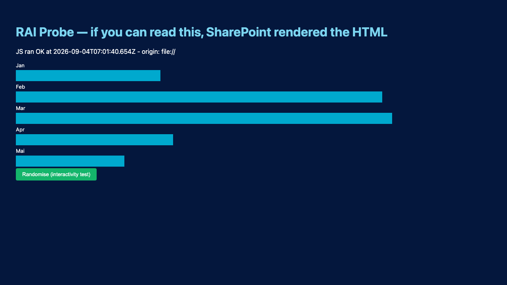

# Tenant Constraints — What SharePoint & OneDrive Actually Do

> **Status:** Empirically verified against an enterprise Microsoft 365 tenant by RAIWork,
> using Microsoft Graph + `curl` + headless Chromium.
> Rows 19-20 (browser-platform, not tenant-policy) come from
> `probe/browser-capability-probe.py`, Chromium `151.0.7922.34`.
> Rows 21-27 are **manual** observations, not automated probes, and are flagged as such
> below. Each is a manual observation on one device, through one sharing path or a small
> set of them: a data point, not a platform-wide guarantee.
> Row 23 was RETRACTED by rows 24-26. It is kept as a table row, not deleted, as a record
> of a conclusion that briefly looked confirmed and was not.
> Rows 24-26 come from one affected file and a series of isolated minimal reproductions.
> `examples/16-embedding-mode-comparison-poc/` in this repo is a reusable diagnostic tool
> covering all four findings.
> Rows 23-26 were all found in one session. Treat that as a signal that this list is not
> exhaustive, not as a sign the search is done; see
> `examples/16-embedding-mode-comparison-poc/README.md` for the open follow-up, including
> the scanning layer behind row 25.
> Row 27 is one Slack attachment opened on a real iPhone, and the same standalone file
> opened through the browser handoff. It records the transport separately from the
> browser result.
> Every row below is a measured observation, not a doc quote.
> Re-run [`probe/tenant-probe.py`](../probe/tenant-probe.py) (rows 1-6) and
> [`probe/browser-capability-probe.py`](../probe/browser-capability-probe.py)
> (rows 19-20) to reconfirm.
>
> The normative write-up that rows 19-22 feed into — what a dashboard is required to do
> about any of this — is
> [`docs/11-responsiveness-and-browser-support.md`](11-responsiveness-and-browser-support.md),
> not this document. This file only ever answers "what happened when we measured it."

This document exists because the entire idea rests on one question, and the answer
is counter-intuitive. **Read this before designing anything.**

---

## The one-line answer

> **SharePoint and OneDrive will not render your HTML as a web page. Ever. By design.**
> Every file you request comes back with `Content-Disposition: attachment`.
>
> **This is not a blocker. It is the delivery mechanism.**
> SharePoint is a permissioned document CDN, not a web server. Build for that and
> everything works — including things Power BI cannot do.

---

## Measured results

| # | Path attempted | Measured result | Verdict |
|---|---|---|---|
| 1 | `.html` in a document library, Graph `downloadUrl` | `200`, `content-type: text/html`, **`content-disposition: attachment`** | ❌ Downloads, never renders |
| 2 | `.aspx` (the classic "rename it" trick) | `200`, **`content-type: application/octet-stream`**, `attachment` | ❌ MIME actively downgraded — deliberately closed |
| 3 | Graph `createLink` `type: "embed"`, `scope: "organization"` | `400 invalidRequest` — *"embed Type … supported only for anonymous Scope"* | ❌ Anonymous sharing is blocked in this tenant |
| 4 | Graph `/preview` → `_layouts/15/embed.aspx` | `200 text/html`, 264 KB of **SharePoint viewer chrome**. Our markup: **0 occurrences**. 9 × "Download" | ❌ Renders a viewer with a Download button, not our page |
| 5 | `<iframe>` from any non-Microsoft origin | `x-frame-options: SAMEORIGIN`<br>`content-security-policy: frame-ancestors 'self' <MS domains>` | ❌ Framing outside SharePoint/Teams/M365 is blocked |
| 6 | **HTTP `Range:` request on file content** | **`206 Partial Content`**, `content-range: bytes 0-99/996` | ✅ **Works** — see "Why this matters" below |
| 7 | **Local open from the OneDrive sync folder (`file://`)** | Renders fully. JS executes. Button click mutates DOM. Title, styling, interactivity all correct | ✅ **Works perfectly** |
| 8 | `fetch()` to SharePoint from a `file://` page | `401 Unauthorized` — reached the server, but unauthenticated | ⚠️ Live data needs a token; MSAL cannot use a `file://` redirect URI |
| 9 | OneDrive sync client on macOS | Present: `~/Library/CloudStorage/OneDrive-SharedLibraries-EksempelAS` | ✅ Distribution channel confirmed |
| 10 | `createLink` `type:"view"`, `scope:"organization"` | `200` — link created | ✅ Internal sharing works |
| 11 | `createLink` `type:"view"`, `scope:"anonymous"` | **`403 notAllowed`** — *"sharing has been disabled"* | ❌ **Anonymous/external links blocked tenant-wide** |
| 12 | `.svg` with an embedded `<script>` | `200`, `content-type: image/svg+xml`, **`content-disposition: attachment`** | ❌ Same treatment — disposition is unconditional |
| 13 | `<iframe>` of a URL sending `Content-Disposition: attachment` *(local control test)* | **renders nothing AND triggers a download.** Same URL with `inline` renders fine | ❌ **This closes every iframe/embed route** |
| 14 | `<script src="./data.js">` from a `file://` page | **loads and executes** — `fetch('./data.js')` from the same page is blocked | ✅ **Paired mode: data in a sibling file** |
| 15 | Swap `data.js`, reload, dashboard HTML untouched | totals, "as of" date and source all update | ✅ **Dynamic data with no server** |
| 16 | Read a sibling **plain** file from `file://` — `fetch`, `XMLHttpRequest`, `<iframe>`+contentDocument, `<object>` | **all blocked** (empty / null / throws) | ❌ The data file must be JavaScript |
| 17 | `FileReader` on a user-dropped file from `file://` | works — CSV parsed, dashboard re-renders | ✅ **Drag-in update, no tooling** |
| 18 | `Blob` + `<a download>` from `file://` | works — dashboard writes its own `data.js` | ✅ **Drag-out publish, no tooling** |
| 19 | `showDirectoryPicker({mode:"readwrite"})` from `file://` — no user gesture, then a real click-triggered gesture | API present; **both** calls return the identical `AbortError` ("user aborted a request") | ⚠️ **Present, but not fully testable headlessly** — see below |
| 20 | `new Worker(URL.createObjectURL(new Blob([src])))` from `file://`, vs. `new Worker("./external.js")` (control) | Blob-sourced worker **runs and round-trips a message**; external-path worker fails with `SecurityError … cannot be accessed from origin 'null'` (same failure as row 8/DuckDB) | ✅ **Inline compute works; loading a worker file does not** |
| 21 | **Manual, not scripted:** open `examples/07-topbar-pattern-demo/topbar-pattern-demo.html` via a real Teams message link, on a real iPhone | Hamburger menu and info panel worked — script execution itself is NOT blocked in this open path. The fullscreen button's unguarded `requestFullscreen()` call threw, and the **host WebView surfaced a visible "Script error" banner to the user**, not a silent console error. Fixed with feature-detection + `try/catch` (`examples/07-topbar-pattern-demo/README.md`); button now disables itself instead | ⚠️ **JS runs fine; Fullscreen API is the specific thing that breaks, visibly, if left unguarded** — exact Teams version and in-app-preview-vs-external-browser not yet isolated |
| 22 | **Manual, not scripted:** one standalone demo file, shared three ways from OneDrive and opened on both a PC and a mobile phone: (a) "Copy link" pasted into an e-mail, (b) the same link pasted into a Teams message — opened via Teams' own auto-generated preview card, (c) the same Teams message — opened via the plain-text link Teams also renders underneath that card | (a) JavaScript ran and everything worked **on PC**; JavaScript did **not** run on mobile at all — menu, theme toggle, info panel, all inert, no console reachable to confirm why. (b) JavaScript ran **on both PC and mobile**. (c) Rendered **source code only**, in neither device — did not execute as a page at all | ⚠️ **The sharing path decides, not the device** — Teams' own preview card is the only confirmed mobile-working route found so far; a raw OneDrive link (e-mail, or OneDrive's own "Send" dialog) only worked on PC. Prompted a host-agnostic warning banner, visible by default and only hidden by a script proven to have run (pattern in `docs/11-responsiveness-and-browser-support.md`). **Not exhaustive** (see the open items at the end of this document): only one phone/OS combination tested, only Outlook (desktop+mobile) and Teams tried, sharing-link scope (organization vs. specific people) not varied |
| 23 | **RETRACTED, same evening it was added:** embedded multi-line string concatenation (`"tekst" +` repeated across lines) in inline `<script>` data, vs. the identical content as one continuous string | A rushed two-test comparison first concluded multi-line concatenation itself broke SharePoint's inline file-preview ("hurtigvisning" in a document library — not row 4's `embed.aspx` viewer, not a download). A **third, better-isolated** test (two panels, side by side, identical file, only line-format different) showed **both render correctly** — see `examples/16-embedding-mode-comparison-poc/`, panel A vs. B. | ❌ **Retracted — was never the cause.** Kept as a table row, not deleted, specifically so this wrong conclusion cannot quietly get re-discovered and re-reported as new. Row 25 has what the format red herring was masking. |
| 24 | **Manual, not scripted:** click on `<a href="#page-x">` navigation inside SharePoint's inline file-preview ("hurtigvisning"), CSS `:target` driving which section is visible — isolated to a bare-minimum test page (3 links, 3 `:target`-styled boxes, nothing else) | Clicking never changed which box was visible — fragment navigation itself did not occur. An **otherwise-identical** page using a JavaScript click handler (`preventDefault()` + toggling a CSS class instead of relying on the browser's own fragment navigation) switched correctly on the first click | ❌ **Fragment navigation (`<a href="#...">` → browser navigates → `:target` matches) is blocked in this preview surface — even though JavaScript itself runs (see row 25).** CSS `:target` is not a safe page-switching mechanism for anything meant to be opened this way. **Preferred fix: `<input type="radio" name="page">` + `:checked`** — checking an input is not navigation, so no fragment is involved, and unlike the JS click handler this keeps working when scripts do not run at all (row 22a). Built and verified in `examples/13-js-free-standalone-poc/`; gated by `tools/verify_standalone_core.py`'s `check_no_target_driven_visibility`. ⚠ The radio replacement itself has NOT yet been opened in this preview surface — that is an open probe, and until then it is a reasoned substitution, not a measured one. A JS click handler remains the fallback where a radio group does not fit |
| 25 | **Manual, not scripted:** a literal `<script` substring appearing anywhere in an HTML file opened via SharePoint's inline file-preview — including *inside an HTML comment*, describing in prose what a sibling `<script src="...">` tag does, never executed by any browser | A file with this exact pattern in its own top-of-file documentation comment rendered a permanent "no JavaScript" fallback state — the file's *own* one-line inline banner-removal script (nothing to do with the comment) never ran either. Removing only the two comment phrases containing the literal text, zero other changes, fixed the file completely. Reproduced in isolation: a 457-byte page with one script tag and nothing else fails identically the moment a second, textual "`<script`" occurrence is added anywhere in the file | ❌ **A naive text scan for "`<script`" across the raw file — not real HTML parsing — appears to gate whether ANY script on the page runs, tenant-side.** Never type the literal characters "`<script`" as prose/documentation anywhere in a file meant to run in this preview surface, comment or not. See `examples/16-embedding-mode-comparison-poc/README.md` for the full bisection |
| 26 | **Manual, not scripted:** `position:sticky` and, separately, `position:fixed` (with a JS-measured `padding-top` compensating on the sibling content) for a header meant to stay visible while the rest of the page scrolls, inside SharePoint's inline file-preview | `position:sticky`: header overlapped/covered the top of the newly-visible content on every page switch, regardless of scroll position. `position:fixed` + measured `padding-top`: same overlap persisted. An app-shell layout with **no positioning property at all** — non-scrolling `<body>` as a `100vh` flex column, the header as a plain non-scrolling flex row, and the content area as the *sole* `overflow-y:auto` container — fixed it completely, confirmed by manual observation in both SharePoint and OneDrive | ❌ **Both `position:sticky` and `position:fixed` are unreliable for anything that must stay visible during scroll in this preview surface**, independent of otherwise-correct CSS. Use a non-scrolling flex-shell with one dedicated scrolling container instead — do not spend more local-browser time trying to fix sticky/fixed further, local rendering already looked correct both times |
| 27 | **Manual, not scripted:** upload a self-contained slide deck as a raw `.html` attachment in Slack, open it on macOS and on an iPhone, then use the iPhone's "open in browser" handoff | Slack on macOS opened the interactive page. Slack's iPhone attachment preview showed the HTML source. The handoff offered Yandex on the tested phone; Yandex rendered the same local file in portrait and landscape. A revised file with persistent touch controls then opened successfully from disk. True fullscreen was not separately confirmed on the device | ⚠️ **The file is portable; the attachment preview is not a browser.** Keep the single offline file as the canonical artefact. Make controls touch-visible and guard fullscreen. Use direct file transfer or an optional hosted URL when a preview surface refuses to execute HTML. One iPhone, one Slack version and one registered browser is a data point, not a platform-wide guarantee |
| 28 | **Scripted against the live tenant, 2026-10-08:** open an `.html` file in SharePoint's inline file preview ("hurtigvisning") from a OneDrive folder, and read the preview frame's attributes from the host page. Then rebuild the same frame locally (a `blob:` iframe with the same `sandbox` value) and drive a page inside it in Chromium, Firefox and WebKit, with a control arm that adds `allow-downloads` | The preview renders the file as `<iframe src="blob:https://<tenant>-my.sharepoint.com/<uuid>" sandbox="allow-scripts">`. Scripts run. The frame has an opaque origin (`self.origin === "null"`) and none of `allow-downloads`, `allow-modals`, `allow-popups` or `allow-same-origin`. In the replica, `Blob` + `<a download>` gave no download in any of the three engines (WebKit logs "Not allowed to download due to sandboxing"). With `allow-downloads` added, all three downloaded, and the file was named after the blob UUID. `window.print()` was ignored in Chromium ("the 'allow-modals' keyword is not set"). Opening the file's own URL instead of the preview downloads it (row 1) | ⚠️ **Scripts run in the preview, but nothing can leave it.** Row 18's drag-out does not work there, and neither does a print button. A page that offers either must detect the frame (`window.self !== window.top && self.origin === "null"`) and tell the reader to download the file and open it from disk. [`examples/24-editable-document`](../examples/24-editable-document/) does this, and the guard was seen to fire in the live preview |

### Verbatim response headers (row 1)

```http
HTTP/2 200
content-length: 996
content-type: text/html
accept-ranges: bytes
content-disposition: attachment;filename*=utf-8''probe%2Ddashboard%2Ehtml;filename="probe-dashboard.html"
x-frame-options: SAMEORIGIN
content-security-policy: frame-ancestors 'self' teams.microsoft.com *.teams.microsoft.com
  *.skype.com ... *.office.com *.microsoft365.com m365.cloud.microsoft *.cloud.microsoft
  ... securebroker.sharepointonline.com;
```

Note the pairing: the MIME type is **honest** (`text/html`) but the disposition is
**forced** (`attachment`). Microsoft is not confused about what the file is — it is
refusing to execute it in the SharePoint origin. That refusal is a deliberate XSS
control, documented under
[security considerations of allowing custom script](https://learn.microsoft.com/en-us/sharepoint/security-considerations-of-allowing-custom-script):

> *"Every script that runs in a SharePoint page (whether it's an HTML page in a
> document library or a JavaScript in a Script Editor Web Part) always runs in the
> context of the user."*

Any workaround that defeats `Content-Disposition: attachment` is, by definition,
defeating a security control in a corporate document store. **We are not going to do
that.** The architecture routes around it instead.

---

**Notes on the table.** Row 25 is enforced by `check_no_stray_script_text()` in
`tools/verify_standalone_core.py`. The check existed from 2026-09-15, but the publish gate
(`tools/verify_dashboard.py`) only started to call it on 2026-09-24. Until then every
dashboard could ship a violation and still pass. Row 12: an SVG with an inline script *does* run its script
when the file is opened directly from disk. SharePoint still forces it to download, so
SVG is no way around the attachment rule. Row 27: Safari on iPhone exposes the
Fullscreen API for `<video>` only, not for an HTML element. A deck therefore needs its
own fallback there. It cannot ask for real fullscreen.

## Why row 6 (Range requests) matters — and where it stops

`206 Partial Content` on SharePoint file content means a browser can read **arbitrary
byte ranges** of a file without downloading the whole thing. That is precisely the
access pattern **Parquet** and **DuckDB-WASM** need, and it works.

**Measured.** DuckDB-WASM 1.32.0 against a 24.41 MB Parquet file
(4 000 000 rows, 8 columns, 4 row groups) served with `Accept-Ranges: bytes` and
`Cache-Control: no-store`, fresh browser context per query:

| query | wall time | HTTP requests | bytes pulled | share of file |
|---|---|---|---|---|
| `count(*)` | 276 ms | 2 | **0.03 MB** | **0.1 %** |
| `count(*) GROUP BY region` | 358 ms | 6 | 1.72 MB | 7.1 % |
| `count(*) GROUP BY kategori, kanal` | 420 ms | 6 | 3.38 MB | 13.9 % |
| `min/max(belop)` | 465 ms | 6 | 12.11 MB | 49.6 % |
| `sum(belop) GROUP BY region` | 493 ms | 10 | 13.79 MB | 56.5 % |
| filtered drill-down | 539 ms | 18 | 17.14 MB | 70.2 % |

`count(*)` is answered from the 32 KB footer alone. Column pruning over the network
is real: `belop` is 4 M uncompressed-ish float64s and is genuinely half the file, so
touching it costs half; the low-cardinality dictionary columns cost 7 %.

### Two traps that silently disable all of it

Both failure modes return **correct results at reasonable speed** while transferring
the entire file. Nothing errors. You only see it on the wire.

1. **`LOAD httpfs` must be executed on the connection.** Without it, the same SQL
   against the same server does 2 requests and pulls 100 % of the file, every time.
   Measured: `count(*)` costs 0.03 MB with it, **24.41 MB** without.
2. **`registerFileURL(..., DuckDBDataProtocol.HTTP, directIO)` does not range-read.**
   Tested with `directIO` both `false` and `true`: one full `GET`, zero `206`
   responses, in both cases. Only querying the URL directly —
   `read_parquet('https://…')` — triggers `HEAD` + byte ranges.

> If you build anything on Tier 3, assert on the *network*, not on the answer. Count
> `206` responses and sum the bytes. A green dashboard proves nothing here.

### Why DuckDB-WASM cannot run from a `file://` page

This is the constraint that decides where Tier 3 can live. The engine needs to load a
worker and a `.wasm` module, and **all three delivery mechanisms are blocked** against
origin `null`:

```
new Worker('./duckdb-browser-eh.worker.js')
  → Failed to construct 'Worker': Script at 'file:///…/duckdb-browser-eh.worker.js'
    cannot be accessed from origin 'null'

fetch('./duckdb-eh.wasm')                 → blocked (same as row 8)
import('./duckdb-browser-blocking.mjs')   → Failed to fetch dynamically imported module
```

Nor can the runtime be inlined to route around it: the `eh` bundle alone is a **33 MB
`.wasm`** plus a 755 KB worker, and `duckdb-browser.mjs` needs `apache-arrow`, which
needs `tslib`, `flatbuffers` and `json-with-bigint` resolved through an import map.

Combined with row 1 — SharePoint always serves `.html` as
`Content-Disposition: attachment`, so a dashboard page there can never *be* an
origin — the conclusion is:

> **Range support is necessary but not sufficient.** Parquet + DuckDB-WASM needs a
> real HTTP origin, which in this tenant means an SPFx web part. Tier 3 rides on
> Tier 2 and inherits its admin approval. It is **not** available to a portable file.

An earlier version of this document called row 6 "the single most valuable finding"
and treated it as making Tier 3 viable on its own. That was a conclusion drawn at the
transport layer without testing whether the engine could boot in the target context.
Corrected here.

### What replaced it for portable dashboards

Large data in a portable file is solved differently: pre-aggregate into a **dense
OLAP cube**, gzip it, and inline it. `DecompressionStream("gzip")` is native and
**does work from `file://`**, which makes it the one viable bulk-data channel there.

Measured: 4 000 000 source rows → 115 200 cells → **0.81 MB `.html`**, decoded in
40 ms, filter clicks at a median of 0.10 ms. See
[`07-portable-cube.md`](07-portable-cube.md).


---

## Rows 19-20 — browser platform, not SharePoint

Rows 1-18 are either a tenant-policy question (does SharePoint serve this file
a certain way) or a question already answered inside the paired-mode work. Rows
19-20 close two remaining doors people ask about — live read/write to a shared
folder, and running real computation without a server — using
[`probe/browser-capability-probe.py`](../probe/browser-capability-probe.py),
Chromium build `151.0.7922.34` via Playwright, no Graph token needed (this is
pure browser behaviour, reproducible in any tenant).

### Row 19 — the File System Access API is real, but cannot be probed past its first line

`window.showDirectoryPicker` exists from a `file://` page. That is what the
local change-queue pattern (used in an internal dashboard) relies on
for a dashboard to read *and write* a change-queue file in its own OneDrive folder,
live, without any server. It had never been run through this discipline before —
it was working code, not yet a measured row.

Two calls were made, and both failed identically:

```
called with no user gesture:            AbortError — "The user aborted a request."
called from a real click event handler: AbortError — "The user aborted a request."
```

The identical failure **is** the finding. It is not evidence that the API requires
a user gesture (though it does, per spec) — it is evidence that **headless Chromium
has no display to draw the native OS folder picker on**, so it cancels the dialog
itself, regardless of whether real user activation was present. Playwright can drive
a click; it cannot drive the native OS chooser behind `showDirectoryPicker`, and there
is no CDP-level interception for it the way there is for `<input type=file>`.

**Consequence for this repo:** row 19 cannot be reduced to a pass/fail exit code like
rows 1-18. The only automatable claims are: the API exists, and it demands genuine
activation. Whether a real grant-then-write-then-reread cycle actually works against
a OneDrive-synced folder on the organisation's tenant has to be checked **by a human, in a headed
browser, once** — and re-checked the same way if this pattern is extended, because
nothing here can catch a regression automatically. Treat any future automated "PASS"
claiming to cover this path with suspicion; it is testing something else.

### Row 20 — a Worker works fine from `file://`, as long as its source never touches a path

Row 8/the DuckDB section already showed `new Worker('./external-file.js')` fails —
`SecurityError`, blocked from origin `null`, same as `fetch`. What had not been tested
is whether a Worker can exist **at all** without a server, and it can: build the source
as a string, wrap it in a `Blob`, load it via `URL.createObjectURL`, and construct the
`Worker` from that object URL instead of a file path. Measured: posted `21` in, got `42`
back — a real thread, running real code, no network, no file path crossed.

This opens a door nothing in this repo has used yet: **client-side computation heavy
enough to want a background thread — a simulation sweep, a large re-aggregation — can
run inside a portable `file://` artefact**, so long as the worker's source is generated
inline rather than referenced. Relevant beyond dashboards: any standalone-HTML
specialization that needs to compute rather than just display (see the generic
artifact-model discussion) can rely on this without waiting on Tier 2/3.

---

## Why row 7 (`file://`) is the whole product

A downloaded, self-contained HTML file **renders perfectly and stays interactive**.
Verified visually:



So the delivery model is:

1. Dashboard is a **single self-contained `.html` file** — data, styles, and JS inlined.
2. It lives in a **SharePoint document library / OneDrive folder**.
3. SharePoint enforces **who may open it** (existing permissions, sensitivity labels,
   DLP, audit, versioning — all for free).
4. The viewer either **double-clicks it in their synced folder**, or clicks in the
   browser and it lands in `~/Downloads`. Either way it opens and works.
5. No licence. No workspace. No capacity. No app registration. No admin ticket.

The "download" that looked like a defeat in row 1 is the same download that makes
the artefact portable, offline-capable, and shareable to anyone — including people
who could never open a Power BI report.

---

## What is genuinely closed off

Be honest about these; do not design around them:

- **Serving a live web app from SharePoint.** Impossible. Rows 1–5.
- **Embedding a dashboard *file* in any page, anywhere.** Rows 12–13 close this
  definitively. `Content-Disposition: attachment` is unconditional across HTML, `.aspx`
  and `.svg`, and in an iframe that disposition renders nothing while triggering a
  download. So it is not a CSP problem, not a Teams problem and not a file-type problem —
  no iframe can ever render a file served from a SharePoint document library.

  Embedding therefore requires content that is **not a file in a library**: an SPFx web
  part (the code becomes part of the page bundle) or an Embed web part in HTML-snippet
  mode (the markup lives in the page). Both are admin-gated, and Microsoft's Baseline
  Security Mode is closing the second one. There is **no unprivileged embedding route.**

  Worth being clear about what that costs us: nothing that matters. Embedding buys
  "appears on a page without clicking a file" — a convenience. Paired mode already
  provides the dynamism, and a file already provides the reach (including outside the organisation,
  which no embedded page can do).
- **Live data from a `file://` dashboard.** Row 8 — no auth path. Data must be
  inlined at build time, or the dashboard must be hosted at a real origin.
- **Anonymous/external sharing links.** Row 3 — blocked at tenant level.
- **Embedding arbitrary HTML in a modern SharePoint page** without either
  tenant-level custom script (which Microsoft's
  [Baseline Security Mode](https://learn.microsoft.com/en-us/microsoft-365/baseline-security-mode/baseline-security-mode-settings)
  now permanently blocks) or an admin-approved SPFx package.

## More than one editor: what a file cannot do

A paired file has exactly one safe writer. This follows from rows already measured. It
is not a separate test.

- **A lock file cannot work.** The page cannot read a sibling plain file (row 16), so it
  cannot see a lock while it is open. It cannot write in place (row 19, only a user
  download in row 18), so it cannot take or release a lock. Sync is not instant, so two
  people can both read "free" and both start. A lock that cannot be taken atomically is
  worse than no lock: it shows a guarantee it does not have. A lock left by a crashed
  browser could also never expire.
- **Conflicts are not merged.** See the first item under *Assumptions still to test*.
- **The real lock is a list, not a file.** A SharePoint list item updated through
  Microsoft Graph with an `If-Match` ETag returns `412 Precondition Failed` and is not
  changed when someone else changed it first (from the Graph documentation, not measured
  here). That gives optimistic concurrency, version history and per-item permissions.
- **The Tún page can never be that editor.** From `file://`, `fetch` to SharePoint gets
  `401`, and MSAL cannot use a `file://` redirect URI (row 8). The split is: people edit
  in SharePoint (or one person edits a file), and the page reads the result.

So: one editor, use paired mode. Several editors at once, use a SharePoint list as the
source and let the page read a snapshot of it. `examples/17` describes this split for a
synthetic case, in the text of its page (`oversikt.template.html`).

## Sharing outside the organisation

Row 11 matters most here: **anonymous SharePoint links are blocked at tenant level.** You
cannot send an outsider a link to a file in our SharePoint.

That does not block external sharing — it means SharePoint isn't the channel.
**The artefact is a single file, so the file is the delivery mechanism:**

- **email it as an attachment** — it renders on the recipient's machine, with no licence,
  no account, and no access to our tenant
- hand it over in a data room, or whatever channel the relationship already uses
- it works offline, in any modern browser, with nothing installed

This is a genuine capability Power BI does not have at all: a `.pbix` cannot be opened by
someone outside the tenant, and a Power BI link requires a licence. A self-contained HTML
dashboard is just a document — and documents already have well-understood routes out of a large enterprise.

⚠️ Which makes the security thinking *more* important, not less. A file that can be emailed
can be emailed to the wrong person, and it carries all its data inside it. Before anything
leaves the organisation: check the classification, confirm the data is meant to be shared, and remember
that **a file you have sent cannot be revoked.**

Untested, and worth knowing: whether a **guest/B2B invite** to a SharePoint site would let a
named external user open a dashboard in place. That's a per-guest admin action, so probably
heavier than just sending the file.

## What is open

- Single-file HTML with inlined rows, distributed as a document. **Tier 1.**
- Single-file HTML with an inlined **dense cube** — millions of source rows in well
  under 1 MB, still zero approvals. **Tier 1.** See [`07-portable-cube.md`](07-portable-cube.md).
- A declarative sidecar (`<script src="./data.js">`) for read-only live-per-open
  updates, no rebuild, no permission prompt. **Tier 1.**
- Live read/write to a shared folder via the File System Access API, for patterns like
  the local change-queue (in real use, but only verifiable end-to-end by a
  human in a headed browser, row 19). **Tier 1, unusual verification cost.**
- An inline Worker (built from a `Blob`, never from a file path) for client-side
  computation that would otherwise block the UI thread — no server, no approval
  (row 20). **Tier 1.**
- SPFx web part for true in-page embedding, if an admin will approve it. **Tier 2.**
- Parquet + DuckDB-WASM over Range requests, for large data with row-level detail.
  **Requires Tier 2 to host it** — measured, not assumed. **Tier 3.** For most cases the
  dense cube is enough. Parquet, SQLite and DuckDB are more useful on the build side, in
  the job that writes the file (see `00-vision.md`, *Live-ish data*).

See [`02-architecture.md`](02-architecture.md) for how the three tiers fit together.

---

## Re-verifying

Constraints change — Microsoft ships tenant policy changes continuously, and
Baseline Security Mode is actively tightening. Before trusting this document:

```bash
python3 probe/tenant-probe.py           # rows 1-6, needs a Graph token — tenant policy
python3 probe/browser-capability-probe.py  # rows 19-20, no token — browser platform
```

The first re-runs the SharePoint/Graph-side rows above and prints a pass/fail table.
The second re-runs the browser-platform rows and prints findings for a human to read —
row 19 has no fixed pass/fail baseline on purpose (see why, above).
Row 7 (`file://` render) is covered by `tools/verify_dashboard.py` instead of either
probe script.
If any row flips, **update this file in the same commit** as whatever you change
in response.

## A new rendering path, documented but not yet measured: SharePoint HTML pages

Microsoft is rolling out **HTML pages in SharePoint** (public preview from October 2026,
general availability announced for late 2026). An `.html` file in a site's **Site Pages**
library renders as a page, not as an attachment preview. This is a different surface from
the inline preview that rows 21-27 measure, so none of those rows carry over in either
direction until it is measured.

What Microsoft's support article "Create, upload, edit, and publish HTML pages in
SharePoint" states (checked verbatim against the fetched page, 2026-10-06):

| Claim | Source wording, short |
|---|---|
| Rendering | "SharePoint renders HTML in a sandboxed iframe ... Content Security Policy (CSP) rules provide extra isolation." |
| JavaScript | "The sandbox supports JavaScript when the code is contained in the same HTML file." |
| Libraries | Chart.js, Mermaid, React, Fluent UI and Babylon from a Microsoft-managed CDN only. |
| Network | "SharePoint blocks arbitrary fetch requests and outbound API calls from HTML pages." |
| Storage | "The sandbox can't access the browser localStorage." |
| Size | "The maximum size is 10 MB." |
| Anchor links | "Navigation within the HTML like anchor links: Yes." |
| Enabling | A site owner turns on Site Pages -> File types -> **Allow HTML files**. |
| Access | Publishing "doesn't grant new permissions"; viewers need permission to view the page. |
| Tenant control | "Can I disable or restrict HTML pages at the tenant level? No." |
| Mobile | View in the SharePoint app in Teams on mobile: yes. |

Why it matters here: a Tún artefact already has exactly the shape this path accepts, all
code and data inline and nothing fetched, and the 0.81 MB cube fits the 10 MB limit with
room to spare. Likely breaks, to measure: anything using `localStorage`, `fetch`, a sibling
`data.js` (paired mode), fullscreen and downloads (both depend on sandbox flags Microsoft
does not list), and inline event-handler attributes (depends on the CSP).

Also note: "Edit in SharePoint" **moves** a file from its document library into Site Pages,
so existing sharing links to the old location are likely to stop working; and editing a
page with Copilot may rewrite the HTML, including the provenance block and Origin Notice.

Status: no row yet. A self-reporting probe page is being prepared; results become row 28.

## Assumptions still to test

These were not verified and should not be relied on until they are:

- [ ] **Two devices editing one synced file offline.** Expected vendor behaviour: the
      OneDrive client does not merge and does not pick a winner. It keeps both files,
      the second with the device name in it (for example `data (Device).js`). The page
      still loads the original, so the second person's edits silently disappear from
      view. This comes from a research report that cited it as measured and then
      admitted it was never tested (2026-09-19). Design as if it is true. Do not quote
      it as measured.

- [ ] Whether an **SPFx web part is approvable** in the organisation's tenant, and what the
      lead time is. This gates Tier 2 entirely.
- [ ] Whether a **Teams tab** (`frame-ancestors` allows `teams.microsoft.com`) can
      host a dashboard — the CSP in row 1 hints this may be a legitimate embed path.
- [ ] Behaviour of **sensitivity labels / DLP** on a `.html` file containing
      business data. A labelled file may behave differently on download.
- [ ] Whether the **Range request** path still works through a sharing link, not
      only through a Graph `downloadUrl` with `tempauth`. Note this only matters for
      Tier 3, which needs Tier 2 to host it either way.
- [x] Practical **file-size ceiling** for a single-file dashboard. Partly answered:
      a 0.81 MB cube-backed file covering 4 M source rows opens instantly from
      `file://`. The remaining unknown is the Outlook/SharePoint *attachment* ceiling,
      not the browser's — and the cube makes it unlikely we ever approach it.
- [ ] Whether `DecompressionStream` is available in every browser the organisation actually
      deploys. Verified in Chromium; it needs Chrome/Edge 80+ or Safari 16.4+. The
      template fails loudly with a readable message rather than a blank page, but a
      locked-down legacy browser in the estate would still block the cube path.
- [ ] **Row 19, end to end, on a real OneDrive-synced folder.** Feature presence and
      the user-gesture requirement are confirmed. A real
      grant → write → close → reopen → reread cycle, against an actual enterprise-tenant
      synced folder, has only been exercised by the local change-queue pattern in
      real use — never captured as a repeatable, scripted check, and per the row
      19 discussion above, it structurally cannot be one. Re-verify by hand if this
      pattern is extended or a browser update changes its behaviour.
- [ ] Whether enterprise browser policy at the organisation **disables the File System Access API**
      outright (some organizations block it via `FileSystemReadAskForUrlAllowedForUrls`-
      style policy or similar). Untested — the probe above only proves the API exists
      in a stock, unmanaged Chromium; a managed browser profile may differ.
- [ ] Row 22 covered exactly one phone, one OS, one mail client, one Teams client,
      and one sharing-link scope. **Untested:** Android, other iOS versions, Gmail/
      other mail apps, Outlook mobile specifically (vs. desktop Outlook, which row 22
      only tried via "Copy link" then pasted into an e-mail, not Outlook's own native
      share/attach flow), a sharing link scoped to specific people vs. the whole
      organization, and whether a genuine e-mail *attachment* (not a link at all)
      behaves like any of the three row-22 paths or like none of them.

