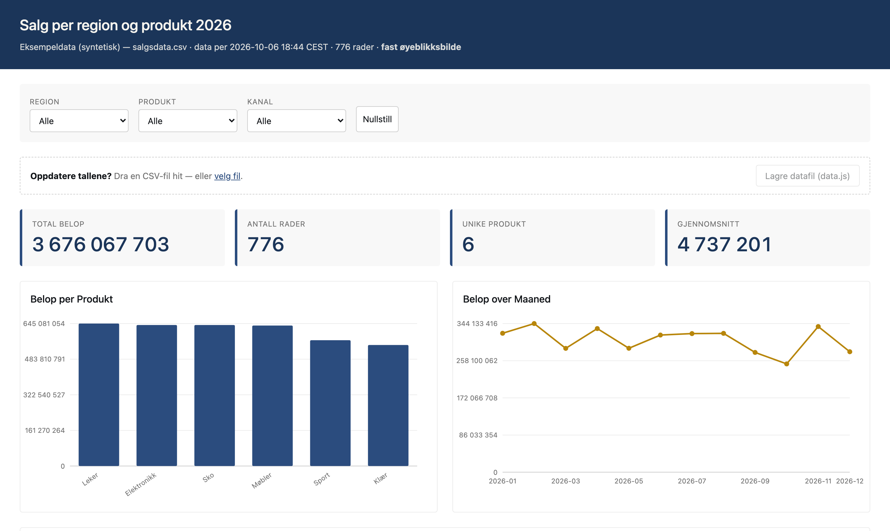

# Onboarding — a new contributor

The idea is simple: OneDrive and SharePoint can carry a dashboard, and that is a way out
of the Power BI licence-and-workspace treadmill. This repo is that idea, written down,
verified against a real enterprise tenant, and turned into something anyone can drive by
asking.

This guide gets you from zero to a published dashboard. It assumes nothing is set up on
your machine yet. Every command below is one line and copy-pasteable, and there is no
build step anywhere in the workflow — the dashboard is just a file.

Estimated time: **about an hour**, most of it installation waiting.

---

## What you are getting

**RAIWork** — a desktop app where you talk to an AI that can actually do things on your
machine: read your Excel files, build dashboards, put them in SharePoint, search Jira and
Confluence, read your mail. Not a chatbot that gives advice; an assistant that does the
work and shows you the result.

Plus **the dashboard skills** in this repo. A "skill" is a set of written instructions
that teaches RAIWork how to do one job properly and consistently. Once installed you can
say *"make me a dashboard from this Excel file"* and it follows the whole recipe —
including the safety checks — every time.

---

## Step 1 — Install RAIWork

**⚠️ This step differs by platform, and if you're on Windows ask a teammate to walk you
through it rather than following a command blind.** Everything *after* this step is
identical on both.

<details>
<summary><strong>Windows</strong> — ask a teammate first</summary>

RAIWork runs on Windows, but your team's install script may be macOS-only, so the setup path
can be different and is not worth guessing at in a document. Ask whoever maintains the
tooling and do it together — it's a short conversation, and getting it right saves you an
afternoon.

What you'll end up with, so you know what "done" looks like:

- the RAIWork app installed and opening
- `git` available
- `python3` available (3.9 or newer)
- `uv` for installing anything (`winget install astral-sh.uv`) — **never `pip`**

</details>

<details>
<summary><strong>macOS</strong></summary>

Install RAIWork with your team's install script, or however your organisation
distributes it. Check that it worked:

```bash
raiwork --version     # check
open -a RAIWork       # launch
```

</details>

> **If any of this fights you, stop and ask the maintainer.** The install is the one part
> of this that's genuinely fiddly and platform-specific. The rest is the interesting bit.

---

## Step 2 — Get this repo

```bash
git clone <your-forge>/<owner>/tun.git
```

---

## Step 3 — Install the dashboard skills

This tells RAIWork about the dashboard skills. One command:

```bash
cd tun && python3 setup.py
```

It copies the skills into RAIWork and checks the one tool the checks need (a headless
browser, used to prove a dashboard really renders before you send it to anyone).

Copies, not shortcuts: the skills RAIWork uses are its own files, so nothing you do in
RAIWork can change this repository by accident. The cost is that they can fall behind
after someone updates a skill here. `python3 setup.py --check` says when that has
happened, and running `python3 setup.py` again brings them up to date.

Then confirm the whole machine is ready:

```bash
python3 setup.py
```

That checks your tools, skills and Microsoft 365 connection, then builds and verifies a
test dashboard to prove the chain works end to end. If anything is missing it prints the
exact command to fix it.

The one thing you **must** see is `✓ ms365 authenticated` — that's the connection to
SharePoint and OneDrive, and nothing can be published without it. If it isn't
authenticated:

```bash
raiwork mcp auth ms365
```

That's a normal sign-in for the organisation. It gives RAIWork exactly the SharePoint
access you already have — nothing more, and no admin approval involved.

[`docs/05-toolchain.md`](05-toolchain.md) explains every tool and why it's there, if you
want the detail.

---

## Step 4 — Build your first dashboard

Open RAIWork. Point it at this repo as its working folder. Then type, in your own words:

> Build me a dashboard from `examples/01-hello-dashboard/salgsdata.csv` — I want to see
> the amounts by product, the trend over the months, and be able to filter by region.

That's it. No flags, no syntax. RAIWork will:

1. ask you the **one important question** — whether different people need to see
   different rows (say no for this example)
2. read the file and tell you what columns it found
3. propose the shape of the dashboard and let you correct it
4. build a single `.html` file
5. **open it in a real browser to prove it works**, and show you a picture of it
6. offer to put it in SharePoint

You should end up with something like this:



One file. 0.1 MB. No licence needed to open it. Works on a plane.

### Then try it with your own data

Same sentence, your file:

> Build me a dashboard from ~/Downloads/mine-tall.xlsx showing …

If it's an Excel file, RAIWork will deal with the conversion. If something about your
data confuses it, it will ask rather than guess.

---

## Step 5 — Publish it

> Put it in the team's SharePoint folder and give me a link I can share.

RAIWork will confirm which folder, tell you **who will be able to see it**, upload it,
and draft the message for you to send. It will not send anything without you saying so.

### The one quirk to know about

When someone clicks the link, SharePoint **downloads** the file rather than showing it
in the page. That is a Microsoft security rule nobody here can change and shouldn't try
to — it's there to stop people running arbitrary scripts from document libraries.

It matters mostly for how you *describe* it to people. Say:

> "Klikk lenken, filen åpnes i nettleseren. Den fungerer også offline etterpå."

Same number of clicks as opening a PDF. And it's the reason the dashboard keeps working
on a train.

---

## What to ask for

You don't need to memorise skill names. Say what you want; RAIWork picks the skill.

| You want to… | Say something like… |
|---|---|
| start something new | *"make me a dashboard from this file"* |
| know if this is even the right approach | *"can this replace our Power BI report?"* |
| update stale numbers | *"refresh the sales dashboard with the new export"* |
| check before sending | *"is this dashboard safe to share?"* |
| share it | *"publish this to the team folder"* |
| move a Power BI report | *"can we move the monthly volume report out of Power BI?"* |

If you're not sure, just ask: *"what can you do with dashboards?"* — that hits the
`tun-help` skill, which routes you and tells you what each option costs.

---

## The one rule that actually matters

> **If different people who open the dashboard need to see different rows of data, this
> approach cannot be used.**

The data lives *inside* the file. Anyone who can open the file can read all of it —
including rows they shouldn't see. There is no safe workaround, and the skills will
refuse and tell you so.

That case needs Power BI with row-level security. Everything else — where everyone sees
the same numbers — is fair game, and that's most reporting.

On freshness: use **paired mode** and the dashboard is a small file next to a `data.js`.
Replace the data file and everyone sees new numbers next time they open it — no rebuild,
no republish. That's how "keep it up to date" works here.

`docs/00-vision.md` has the full honest comparison if you want to argue the case with
someone.

---

## Where things are

| Path | What it is |
|---|---|
| `docs/00-vision.md` | why this exists, and the honest Power BI boundary |
| `docs/01-tenant-constraints.md` | **what SharePoint actually does** — all measured, not guessed |
| `docs/02-architecture.md` | the three delivery tiers and what each costs in approvals |
| `docs/03-skill-tree.md` | the skills, how they fit together, what's built vs planned |
| `docs/05-toolchain.md` | every skill, MCP server and CLI tool needed, and why |
| `docs/06-way-of-working.md` | how we work, `hotshot`, and which general skills help |
| `skills/` | the skills themselves — plain English, readable, editable |
| `templates/` | the dashboard template |
| `examples/` | a working example with sample data |
| `ROADMAP.md` | what's next and what's blocked |

Read `docs/01-tenant-constraints.md` at some point. It's the document that turns "I
think this works" into "I know exactly what works and why". Every row was tested against
the live tenant.

---

## Your first real contribution

The skills are **plain English files**, not code. If RAIWork does something in a way you
don't like — wrong chart, wrong wording, missing a question you'd always ask — open the
relevant `skills/*/SKILL.md` and change the instruction. That's the whole mechanism.

You know the business questions and how colleagues actually consume reports better than
whoever wrote the skill first. That knowledge belongs in these files.

Highest-value thing you could add early: **a use-case list** of the real
reports in your area that could move, and which ones can't and why. The "can't" list is
the more valuable half; it draws the real boundary and stops us re-arguing it every time.

---

## Open questions we still need answers to

Not blockers for Tier 1, but they shape what's possible next. If you have a route to any
of these, that unblocks real capability:

- [ ] **Can an SPFx web part get through tenant admin review?** This gates dashboards
      rendering *inside* a SharePoint page rather than as a downloaded file. Currently
      unproven — needs one package taken end-to-end through the app catalog.
- [ ] **Would a Teams tab work as a host?** The security headers hint it might be a
      legitimate embed path. Untested.
- [ ] **How do sensitivity labels behave** on an `.html` file with business data in it?
- [ ] **Which reports should move first?** Whoever owns the reporting backlog is better
      placed to answer this than anyone.

---

Any of this being unclear is a bug in the guide, not in you. Open an issue or fix it
directly — the guide is as editable as everything else here.

---

## Quick reference

| Command | What it does |
|---|---|
| `python3 setup.py` | install the skills, check everything, run a real smoke test |
| `python3 setup.py --check` | check only, change nothing — reports skills that fell behind |
| `python3 setup.py --hooks` | turn on the pre-commit gate (this repo has no CI; see docs/06) |
| `raiwork mcp list` | see which systems RAIWork is connected to |
| `raiwork mcp auth ms365` | sign in to SharePoint/OneDrive |
| `python3 probe/tenant-probe.py` | re-verify what SharePoint does with HTML files |
