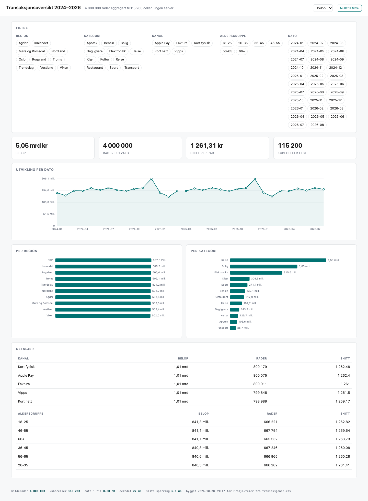

# 03 — Cube dashboard: 4 000 000 rows in a 0.81 MB file

This example exists to prove one claim with numbers you can reproduce:

> A single portable `.html` file can answer any question about **4 million rows**,
> exactly, in under a millisecond, with no server, no licence and no approval.



---

## Reproduce it

```bash
# 1. generate synthetic source data (~207 MB, gitignored — never committed)
python3 examples/03-cube-dashboard/generate_data.py

# 2. build the dashboard from it
python3 tools/build_cube_dashboard.py \
    --data examples/03-cube-dashboard/transaksjoner.csv \
    --dims region,kategori,kanal,aldersgruppe \
    --time dato --time-grain month \
    --measures "belop:sum:kr,antall:sum" \
    --title "Transaksjonsoversikt 2024–2026" \
    --requested-by "Prosjekteier" \
    --out examples/03-cube-dashboard/transaksjoner.html

# 3. prove it renders and the filters actually work
python3 tools/verify_dashboard.py examples/03-cube-dashboard/transaksjoner.html
```

Everything is stdlib Python except step 3, which needs Playwright to drive a real
browser. The generator is seeded, so your numbers will match the ones below.

---

## Measured

Build, on a MacBook:

```
source rows   : 4,000,000
cube cells    : 115,200  (100% populated)
cube raw      : 1.38 MB
gzip          : 0.60 MB
base64 inlined: 0.80 MB
transaksjoner.html: 0.81 MB
reduction     : 35x fewer cells than source rows
```

Build time: **22 s**. Data generation: 12 s.

In the browser, opened from `file://` (no server):

| | |
|---|---|
| base64 decode | 24 ms |
| gunzip (native `DecompressionStream`) | 16 ms |
| first full roll-up over all 115 200 cells | 12.6 ms |
| **each filter click** | **0.00 – 1.30 ms** (median 0.10 ms) |

Correctness, cube against a straight `csv.DictReader` pass over the 4 M source rows:

| measure | ground truth | dashboard | delta |
|---|---|---|---|
| `sum(belop)` | 5 045 238 579.35 | 5 045 238 579.35 | **exact** |
| `sum(antall)` | 5 798 082 | 5 798 082 | **exact** |
| rows | 4 000 000 | 4 000 000 | **exact** |

Exact to the øre, because the builder scales each measure to the smallest factor that
keeps every cell an exact `int32` and records that factor for the browser to undo.

---

## What is in the file

Nothing external. No CDN, no chart library, no WASM:

- the cube: `base64(gzip(int32 belop ‖ uint32 antall ‖ uint32 count))`, 115 200 cells each
- ~250 lines of JavaScript: decode, roll-up, hand-rolled SVG charts
- the CSS

The browser reconstructs typed-array views straight over the inflated buffer and sums
the selected cells in place. That is why a filter click costs a tenth of a millisecond:
there is no hashing, no allocation per cell, and no data to fetch.

---

## What it cannot do

Read [`docs/07-portable-cube.md`](../../docs/07-portable-cube.md) before promising this
to anyone. In short: no row-level drill (the rows are gone), no dimensions that were not
compiled in, additive measures only, and **still no row-level security** — if the answer
depends on who is looking, that is a Power BI job.
