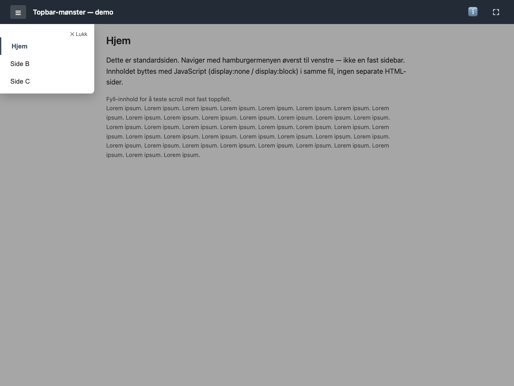
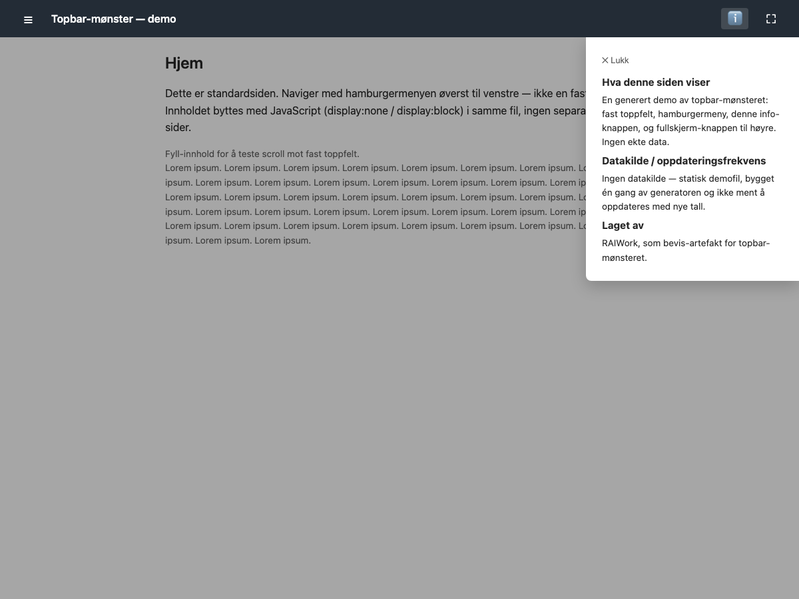

# 07 — Topbar-mønster: nøytral demo

Beviser topbar-mønsteret fra `docs/09-usability-and-navigation-principles.md`
(fast toppfelt, hamburger → overlay-meny, info-panel, fullskjerm-knapp) i en
generert, selvstendig fil — bevisst uten branding.




## Reproduser

```bash
python3 examples/07-topbar-pattern-demo/build_topbar_demo.py
python3 tools/verify_standalone_core.py examples/07-topbar-pattern-demo/topbar-pattern-demo.html
python3 examples/07-topbar-pattern-demo/verify_topbar_demo.py
```

`verify_standalone_core.py` sjekker kun at filen er selvstendig, innen
størrelsesbudsjettet og rendrer uten konsollfeil — den klikker ikke på noe.
`verify_topbar_demo.py` er skrevet for denne demoen spesifikt, og klikker
faktisk på hamburgermeny, navigasjon, info-knapp, lukk-knapp og
fullskjerm-knapp, og sjekker DOM-tilstanden etterpå — i en ekte
(headless) nettleser, ikke bare at scriptet kjører uten feil.

## Én reell feil funnet av testen, rettet før commit

Første versjon stolte kun på "klikk utenfor panelet for å lukke" (en
overlay-`<div>` med `onclick`). `verify_topbar_demo.py` prøvde å klikke midt
på skjermen (Playwrights standard klikkpunkt for et element) på en
390px-bred mobilviewport, og timet ut — fordi info-panelet
(`width:min(320px,90vw)` ≈ 351px på denne bredden) dekker nesten hele
overlayet. Treffområdet for "utenfor" var en ~39px-stripe helt til venstre
under toppfeltet, ikke midten av skjermen.

**Rettet ved å legge til en synlig ✕ Lukk-knapp** i både menyen og
info-panelet, som primær måte å lukke på — klikk-utenfor er nå en
sekundær, ikke den eneste, veien. Testen bekrefter begge veier fungerer
(se `verify_topbar_demo.py`, trinn 4 og 4b).

Dette er samme feilklasse som prosjektets egen "en grønn port er ikke et
riktig resultat"-regel: testen som bare sjekker at scriptet kjører uten
unntak ville aldri fanget dette — det krevde en test som faktisk klikker
og sjekker DOM-tilstanden, på en realistisk mobilbredde.

## Hva denne demoen IKKE beviser

Mobil-åpning (vanskelig å starte navigasjonen når filen åpnes fra en
Teams-melding/lenke på mobil) er **ikke** testet av dette alene — det kan
ikke gjøres fra denne sandkassen. Denne demoen beviser at mønsteret
fungerer i en standard nettlesermotor; det er forutsetningen for at
mobiltesten (faktisk sende denne filen i en Teams-melding til en telefon) er
verdt å kjøre, ikke en erstatning for den.

## Første ekte mobiltest — resultat

En manuell test åpnet en tidligere versjon av denne filen (uten
`try/catch`-hardingen under) via en Teams-lenke på mobil.
Resultat, **målt**:

- Hamburgermeny: fungerte.
- Info-knapp: fungerte.
- Fullskjerm-knapp: viste en synlig feilbanner i selve WebView-hosten
  ("Noe av innholdet ble ikke lastet inn... Script error. Script error."),
  ikke bare en stille feil i konsollen.

Dette avkrefter hypotesen om at Teams' forhåndsviser ikke
kjører JavaScript overhodet — scriptet kjørte åpenbart, siden to av tre
knapper virket. Det bekrefter hypotesen om at Fullscreen-API er dårlig støttet i
innebygde WebViews, men avdekket samtidig en reell bug i denne demoen:
`toggleFullscreen()` kalte `requestFullscreen()` ubeskyttet, uten
feature-detection eller `try/catch`. Når metoden ikke fantes eller kastet i
den aktuelle WebViewen, ble det en ufanget exception som verten selv fanget
opp og viste til brukeren som en feilmelding — enda resten av siden
fungerte helt fint.

**Rettet:** `fullscreenSupported()` sjekker `requestFullscreen`/vendor-prefixer
og `document.fullscreenEnabled` ved lasting og deaktiverer `#fs-btn` direkte
hvis støtte mangler, og selve kall-koden er pakket i `try/catch` med
`.catch()` på løftet uansett — forsvar i dybden, ikke bare den ene sjekken.
Bevist av `verify_topbar_demo.py` trinn 6, som simulerer et miljø uten
Fullscreen-API (fjerner `requestFullscreen`/`exitFullscreen` fra prototypen
før siden lastes) og sjekker at (a) knappen blir deaktivert og (b) et
tvunget klikk uansett ikke gir noen ufanget feil.

**Ikke logget presist ennå:** enhet er bekreftet — **iPhone**, via en ekte
Teams-meldingslenke. Fortsatt ukjent: nøyaktig
Teams-versjon, og om filen ble åpnet i Teams' egen forhåndsviser eller i en
ekstern nettleser via "Åpne i nettleser". Android er ikke testet. Loggført
som rad 21 i `docs/01-tenant-constraints.md`, markert som en manuell test,
ikke en automatisert probe.

**Etter fiksen, bekreftet på samme iPhone:** fullskjerm-knappen deaktiverer
seg selv i stedet for å vise feilbanneret. Ingen ny feilmelding rapportert.
