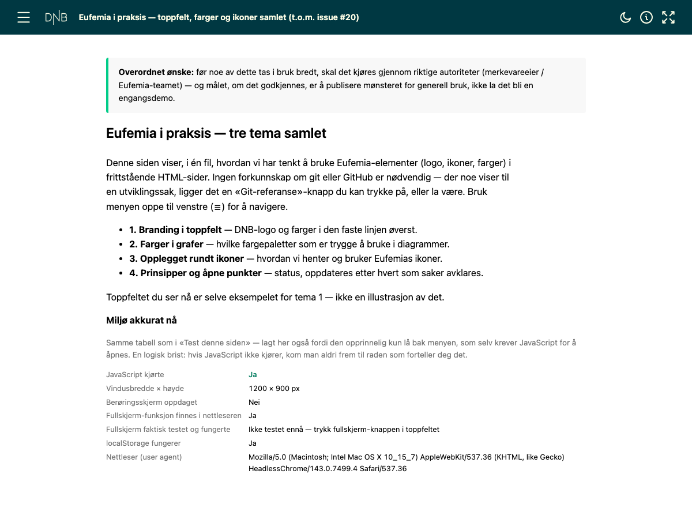

# 10 — Consolidated standalone demo: the JavaScript-resilience pattern for issue #22

Combines prior demos (topbar mechanics #15, Eksempel AS logo #17, branded topbar + the design system icons
#19/#20, theme toggle + colour tokens #12/#14) into one file, and is the artefact three
real sharing paths were tested against for [issue #22](https://example.com/tun/issues/22)
— logged as row 22 in [`docs/01-tenant-constraints.md`](../../docs/01-tenant-constraints.md).
The normative write-up of what this proves is
[`docs/11-responsiveness-and-browser-support.md`](../../docs/11-responsiveness-and-browser-support.md)
§3b/§4 — read that first if you want the "why," not just the "what."



## Reproduce

```bash
python3 examples/10-consolidated-standalone-demo/build_consolidated_demo.py
python3 tools/verify_standalone_core.py examples/10-consolidated-standalone-demo/consolidated-standalone-demo.html
```

`verify_standalone_core.py` only checks the file is self-contained, within the size
budget, and renders without a console error. It does not (and cannot, headlessly) prove
the pattern below actually degrades correctly, because the point of the pattern is what
happens when a script *doesn't* run — see "What this does NOT prove."

## The pattern this file exists to demonstrate: assume your own JavaScript might not run

Row 22 of `docs/01-tenant-constraints.md` found that the same file, shared three ways
from OneDrive, produced three different outcomes on mobile — and one of those outcomes
was total silence: no error, no console, just an inert page. A dashboard cannot detect
that case with a `try/catch`, because nothing ran to catch. The only thing that can react
to "my script didn't run" is markup that doesn't depend on that script — HTML/CSS alone.

Three layers, in the order they appear in `build_consolidated_demo.py`:

1. **A warning box, visible by default, in plain HTML/CSS** (`#js-warning`). No
   JavaScript is required to see it — that's the point.
2. **The earliest possible inline `<script>` in the document** hides it. Reaching that
   line and executing it *is* the proof that some JavaScript ran. This is deliberately
   not a `<noscript>` tag: `<noscript>` only fires when scripting is formally switched
   off, which is not the same failure as a host silently blocking this file's specific
   `<script>` tags while leaving scripting "on" everywhere else.
3. **A delayed check for a completion flag** (`window.__appReady`, set as the very last
   line of the main script). If it's still unset after a timeout, the box reappears with
   a *different* message — "started but didn't finish" is a real crash partway through,
   not the same thing as "never started at all," and a reader trying to report the
   problem needs to know which one happened.

A fourth, related fix in this file: the live diagnostics block (`renderDiagnostics()`,
"Miljø akkurat nå") — screen size, touch detection, fullscreen support, `localStorage`
availability — is on the page itself, in the open, not behind the hamburger menu the way
an earlier version had it. A self-diagnostic that requires the very mechanism it's meant
to diagnose (JavaScript, menu interaction) to become visible is a dead end for exactly
the reader who needs it most.

The fullscreen button reuses the feature-detection + `try/catch` fix from
[`examples/07-topbar-pattern-demo/`](../07-topbar-pattern-demo/README.md) unchanged — that
fix (never call `requestFullscreen()` unguarded) predates this file and is not
re-explained here.

## What this does NOT prove

- That the pattern works against a *real* blocked-JS case. Everything above was built and
  tested against **simulated** failures in a sandbox (script removed, exception forced
  mid-run). It has not been verified against an actual instance of a host blocking script
  execution the way row 22a's mobile e-mail-link case did — that case showed *zero*
  reaction (no console, nothing to catch), which is a harder thing to reproduce than to
  simulate. Tracked as an open item in `docs/11` §"Open items" and in issue #22.
- That this generalises beyond the three sharing paths actually tested. Row 22 is three
  data points (one phone, one mail app, one Teams client), not a matrix. See issue #22 for
  what is still untested (Android, other mail clients, real attachments, sharing scope,
  other mobile browsers).
- That any of this is wired into the production templates. It isn't — see
  `docs/11-responsiveness-and-browser-support.md` §1 and §12. This file is where the
  pattern is proven, not where it ships from.
