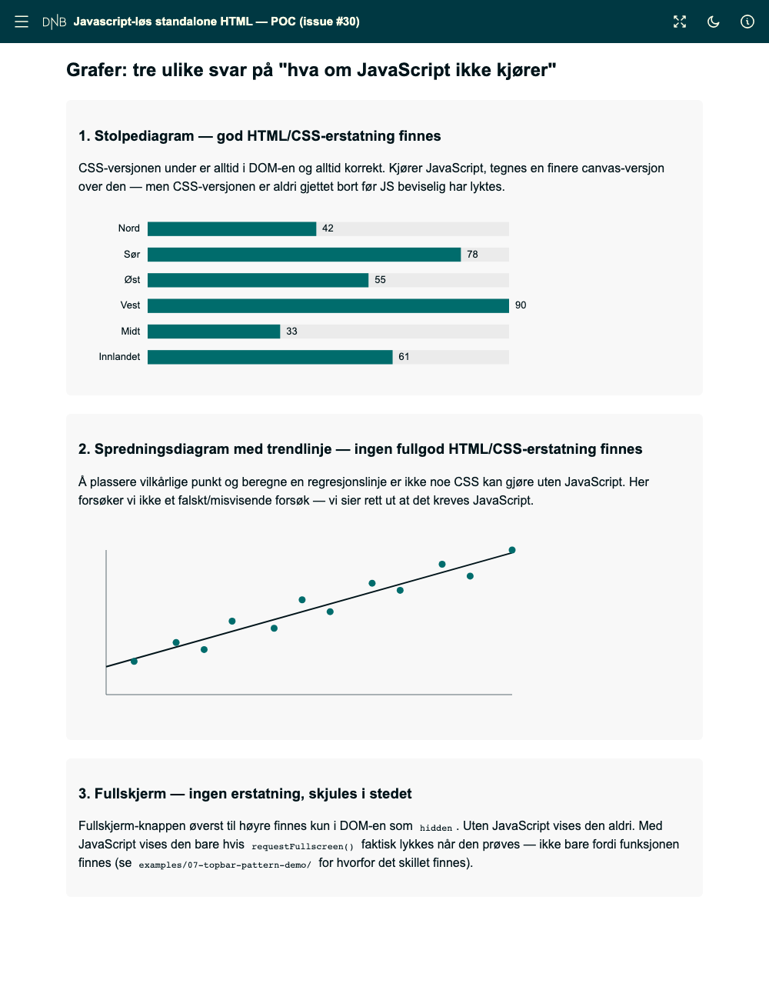
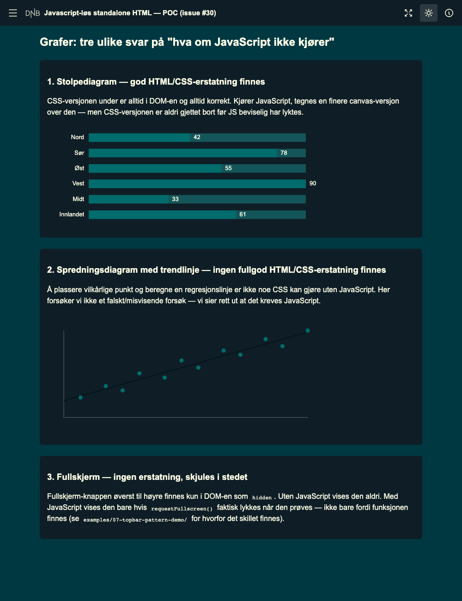
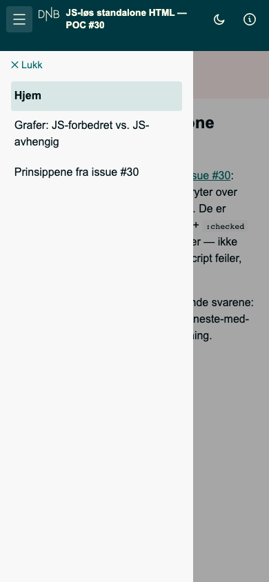
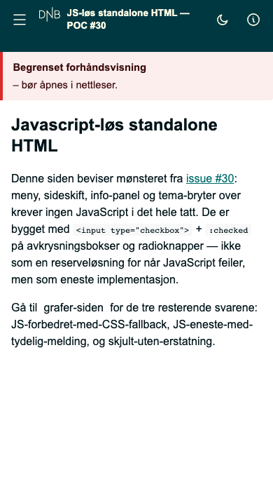

# 13 — Javascript-løs standalone HTML: POC for issue #30

Beviser mønsteret fra [issue #30](https://example.com/tun/issues/30)
på en ekte, renderbar fil — ikke bare i prosa. Rører ikke
`examples/10-consolidated-standalone-demo/`, som fortsatt er
JavaScript-drevet slik den alltid har vært; dette er et separat
sammenligningspunkt, ikke en erstatning.






## De fire svarene, hver demonstrert konkret

| # | Situasjon | Løsning i denne filen |
|---|---|---|
| 1 | Usynlig for brukeren om det byttes (meny, sideskift, info-panel, tema) | **Null JavaScript.** `<input type="checkbox">` + CSS `:checked` for meny/tema/info, og `<input type="radio">` + `:checked` for sideskift. Ikke en reserveløsning — det finnes ingen JS-variant av dette i filen i det hele tatt. |
| 2 | God HTML/CSS-erstatning finnes (stolpediagram) | CSS-versjonen (stablede `<div>`-er) ligger alltid i DOM-en. JavaScript tegner en finere canvas-versjon over den — men skjuler CSS-versjonen først **etter** at canvas-tegningen faktisk lyktes. |
| 3 | Ingen god erstatning finnes, men innhold forventes (spredningsdiagram med trendlinje) | Ingen forsøk på en falsk/misvisende CSS-tilnærming. Viser i stedet, ordrett: *«Krever JavaScript som ikke er støttet i denne visningen.»* |
| 4 | Ingen erstatning finnes, og funksjonen er en ren bonus (fullskjerm) | Knappen har `hidden` i markup fra start. Vises kun hvis JavaScript kjører **og** `requestFullscreen()` faktisk lykkes når den prøves — feilslått forsøk skjuler den igjen, i tråd med lærdommen fra `examples/07-topbar-pattern-demo/` (issue #15/#16): ikke stol på at funksjonen *finnes*, reager på et faktisk avvist forsøk. |

## Reproduser

```bash
python3 examples/13-js-free-standalone-poc/build_js_free_poc.py
python3 tools/verify_standalone_core.py examples/13-js-free-standalone-poc/js-free-standalone-poc.html
python3 tools/verify_app_shell.py examples/13-js-free-standalone-poc/js-free-standalone-poc.html
python3 examples/13-js-free-standalone-poc/verify_js_free_poc.py
```

`verify_js_free_poc.py` er den som faktisk beviser poenget: den laster filen
**to ganger** i en ekte (headless) nettleser — én gang med JavaScript av
(`java_script_enabled=False`, Playwrights nærmeste tilnærming til #22s
funn om at skripting rett og slett ikke kjører i enkelte mottaks­kontekster),
én gang med JavaScript på — og sjekker at meny, sideskift og tema-bryter
virker identisk begge veier, og at graf-/fullskjerm-oppførselen følger
tabellen over presist.

## Hvordan checkbox-hacken faktisk er strukturert

De tre checkboksene (`#menu-toggle`, `#theme-toggle`, `#info-toggle`) ligger
som **direkte søsken av `#app-root`**, altså tidlig i `<body>`, ikke inni
`<header>`. Grunnen: CSS' søsken-kombinator (`~`) krever at checkboksen og
det som skal endres deler samme forelder — en checkbox nøstet inni
`<header>` kan ikke nå `<nav id="nav-menu">` som ligger utenfor headeren.

De tilhørende `<label>`-elementene er likevel plassert som **umiddelbare
DOM-søsken** av hver checkbox, og visuelt flyttet inn i toppfeltets rad med
`position:fixed` på faste koordinater. Det gir to ting samtidig:

1. `:checked ~ #app-root ...`-selektorene virker (checkbox og mål deler
   forelder `#app-root`).
2. `#checkbox:focus-visible + label` gir en ekte, riktig plassert
   fokusring på det synlige ikonet — det vanlige tilgjengelighets­hullet i
   checkbox-hack-menyer (checkboksen får fokus, men ringen vises ikke der
   knappen faktisk er) oppstår ikke her.

Sideskift bruker en **radiogruppe**, ikke CSS `:target`. Tre
`<input type="radio" name="page">` ligger rett før `#app-root`, av samme
søsken-kombinator-grunn som avkrysningsboksene, og `#nav-home` har `checked`
slik at landingssiden er eksplisitt HTML-tilstand. Menyoppføringene er
`<label for="nav-…">`.

Dette var CSS `:target` til og med #50. `docs/01-tenant-constraints.md` rad 24
måler at fragment-navigasjon **ikke skjer i det hele tatt** i SharePoints
innebygde forhåndsvisning, selv om JavaScript kjører der (rad 25) — så
`<a href="#page-x">` gjorde aldri `#page-x` til `:target`, siden byttet aldri,
og ingenting rapporterte en feil. Det virket perfekt fra `file://`, som er
grunnen til at den lokale verifikatoren her gikk grønt i ukevis. Å krysse av en
radioknapp er ikke navigasjon, og trenger derfor ingen fragment-navigasjon.

To bieffekter, begge til det bedre: URL-en får ikke lenger et `#page-…`-fragment
ved sidebytte, og `#page-home` trenger ikke lenger ligge sist i DOM-en.

## Kjente, bevisste begrensninger (ikke skjult, se AGENTS.md-ånden)

- ~~**"Aktiv" styling på navigasjonsknappen mangler.**~~ **Løst i #50.**
  Begrunnelsen for å utelate den var at `:target` ikke kunne nå tilbake til
  *lenken* uten `:has()` eller JavaScript. Radiogruppen kan:
  `#nav-charts:checked ~ #app-root .navlink[for="nav-charts"]` gir en synlig
  gjeldende-side-markør, som `docs/09` §5 (Nielsen Norman Group) ba om.
  Markert med både vekt og bakgrunn, ikke farge alene (WCAG 2.2 1.4.1).
- **Meny lukkes ikke automatisk ved sidevalg — uten JavaScript.** Faktisk
  testet (ikke bare antatt): en `<a>` nøstet inni `<label for="menu-toggle">`
  trigger IKKE checkboksen ved klikk, i noen nettleser — lenkens egen
  standardhandling (navigering) overstyrer label-ens implisitte
  "aktiver kontrollen min". Det finnes ingen ren CSS-vei rundt dette. Med
  JavaScript er det løst som en valgfri forbedring (`autoCloseMenuOnNavigate`
  i SCRIPT) — uten JavaScript lukker leseren menyen manuelt med ✕-knappen,
  som fortsatt virker uendret.
- **Paneler lukker ikke hverandre automatisk.** Meny og info-panel er to
  uavhengige checkbokser — å åpne den ene lukker ikke den andre. En ekte
  løsning (radioknapper med en delt `name` og en skjult "ingen"-verdi)
  finnes, men er ikke bygget her; vurdert som lav nok konsekvens for en POC.
- **Tema-valget huskes ikke mellom sideåpninger.** `localStorage` krever
  JavaScript. Uten JS er dette en ren økt-innstilling — nullstilles ved
  omlasting. Med JS kunne det vært lagret, men er bevisst ikke lagt til her
  for å holde skriptmengden minimal, i tråd med oppdraget for denne POC-en.
- **`prefers-color-scheme` er ikke brukt** som automatisk utgangspunkt for
  tema — kun manuell bryter. Verdt å vurdere i en videreføring.

## Kosmetiske bugs funnet ved manuell gjennomgang og rettet

Fire reelle feil ble funnet av et ekte blikk på skjermbildet, ikke av de
automatiske sjekkene (som bare tester tilstand/synlighet, ikke visuell
plassering) — nøyaktig grunnen til at `tun-verify`-familien alltid
krever et menneske som ser på resultatet:

1. **logoen lå oppå hamburgerikonet.** Toppfeltet hadde ikke
   venstre-innrykk til å gi plass til den fastposisjonerte
   hamburger-toggelen som ligger over den. Rettet med `padding-left:56px`
   på `#topbar`.
2. **Måne-/sol-ikonet byttet ikke ved temaskift.** Reell bug, ikke bare
   visuell: CSS-regelen pekte på `#theme-toggle:checked ~ #app-root
   .theme-icon-light`, men ikonene ligger inni `#theme-toggle-label`, som
   er et SØSKEN av `#app-root` — ikke et barn av det. Selektoren kunne
   aldri treffe. Rettet ved å peke rett på label-søskenet.
3. **Måne-ikonet var ikke vertikalt justert likt de andre.** De to
   ikon-spannene (lys/mørk) manglet egen `inline-flex`-sentrering, så
   SVG-ens naturlige basisverdi (baseline) ga et par pikslers forskyvning.
   Bekreftet rettet med eksakte `getBoundingClientRect()`-mål — alle fire
   ikonene har nå identisk `top`/`bottom` (19–37px).
4. **Hover fungerte kun på fullskjerm-knappen.** De tre andre knappene har
   en usynlig, fastposisjonert checkbox liggende OVENPÅ sin egen synlige
   `<label>` (nødvendig for at klikk/tastatur skal treffe riktig element) —
   musepekeren "henger over" checkboksen, aldri label-en, så
   `.toggle-label:hover` ble aldri sant. Fullskjerm-knappen er et vanlig
   `<button>` uten dette laget, derfor virket hover kun der. Rettet med
   `#toggle:hover + label`.

Alle fire er rene CSS-rettelser — ingen av dem krevde JavaScript, og ingen
av dem endrer noe ved selve null-JS-navigasjonsmønsteret.

## Nye funksjoner lagt til etter første runde

- **«Begrenset forhåndsvisning»-varsel (rosa bånd).** Vises helt øverst på
  siden, og på nytt over stolpediagrammet og spredningsdiagrammet, når
  JavaScript ikke har lyktes. Et ett-linjers inline-`<script>` rett etter
  hvert varsel fjerner det umiddelbart hvis skriptet i det hele tatt kjører
  — uten JS eksekverer den linjen aldri, så varselet blir stående. Dette
  fanger opp *alle* JS-avslåtte tilfeller i én global melding, i tillegg
  til at graf-spesifikke varsler forklarer nøyaktig hva som mangler akkurat
  der.
- **Toppfeltet bryter tittelen over to linjer på smale skjermer** (≤480px)
  i stedet for å klippe den eller la den kollidere med ikonene til høyre.
  Fullskjerm-knappen fjernes helt på denne bredden (sjelden nyttig på
  mobil uansett) for å frigjøre plass — samme «ingen god erstatning →
  skjul den helt»-prinsipp som resten av POC-en bruker for fullskjerm på
  alle bredder. En kortere mobilvisnings-tittel («JS-løs standalone HTML —
  POC #30») brukes samtidig, ren CSS `display`-veksling, ingen JavaScript.
- **`--topbar-h`** er nå én enkelt CSS-variabel brukt overalt et element
  må vite toppfeltets høyde (innholdsområdets `padding-top`, info-panelets
  `top`, menyens `padding-top`) — endres høyden ett sted (f.eks. i
  mobil-media-queryen), følger alt annet med automatisk.


## Filer

- `build_js_free_poc.py` — genererer HTML-en. Kjør denne, ikke rediger
  `.html`-filen for hånd (samme regel som resten av `examples/`).
- `js-free-standalone-poc.html` — den genererte, selvstendige filen.
- `verify_js_free_poc.py` — Playwright-basert bevis, JS på og av.
- `preview-*.png` — skjermbilder til manuell gjennomgang: `preview-js-charts-light.png`
  og `-dark.png` (grafer, begge tema, JavaScript på), `preview-nojs-menu.png`
  (hamburgermeny åpen med JavaScript avslått, mobilbredde) og
  `preview-nojs-home.png` (hjemmeside, JavaScript avslått, mobilbredde).
