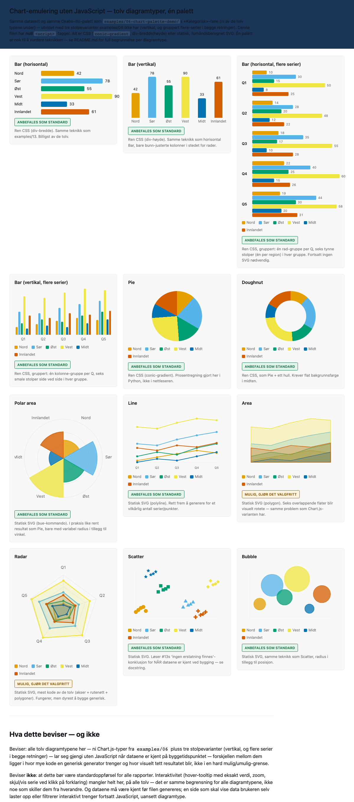

# 14 — Chart-emulering uten JavaScript: hvilke av de tolv diagramtypene tåler det?

Diagnostisk oppfølging av JavaScript-fri standalone HTML
(`examples/13-js-free-standalone-poc/`). Rører ikke `examples/06-chart-palette-demo/` —
bruker samme datasett og samme Okabe–Ito-palett derfra for ni av de tolv typene (én palett
er nok til å vurdere selve teknikken), utvidet med tre stolpevarianter examples/06 ikke har
(vertikal, og gruppert flere-serier i begge retninger). Alle tolv bygges med
**null `<script>`-tagger**.



## Hvorfor dette er et annet spørsmål enn i examples/13

`examples/13` konkluderte at spredningsdiagram+trendlinje **ikke** har en ærlig
CSS-erstatning — det stemmer fortsatt for *den* filen, fordi grafene der skal kunne
vise data JavaScript ikke har fått kjørt og dermed ikke regnet ut ennå (regresjonslinjen
finnes bare hvis skriptet kjører).

Denne filen stiller et annet spørsmål: **hva om dataene allerede er kjent når filen
lages?** Da kan Python gjøre nøyaktig den samme koordinatregningen en nettleser ellers
ville gjort i JavaScript, og bake svaret inn som statisk CSS eller SVG — ingenting
beregnes i nettleseren, men resultatet er identisk fordi input aldri endrer seg. Det er
nøyaktig situasjonen for et øyeblikksbilde-/rapport-dashboard (som resten av dette
repoet er bygget for) — ikke for et skjema der brukeren laster opp egne tall.

## De tolv diagramtypene, vurdert ved å faktisk se på resultatet

| # | Diagramtype | Teknikk | Vurdering | Begrunnelse |
|---|---|---|---|---|
| 1 | Bar (horisontal) | Ren CSS (div-bredde) | ✅ Anbefales som standard | Samme teknikk som `examples/13`. Billigst av de tolv, null overraskelser. |
| 2 | Bar (vertikal) | Ren CSS (div-høyde) | ✅ Anbefales som standard | Samme teknikk som horisontal Bar, bare bunn-justerte kolonner i stedet for rader. Like billig. |
| 3 | Bar (horisontal, flere serier) | Ren CSS, gruppert | ✅ Anbefales som standard | Én rad-gruppe per Q (5 grupper), seks tynne stolper (én per region) i hver. Fortsatt ingen SVG nødvendig — bare mer nøstet markup. Blir naturlig høy med mange grupper/serier; ren layoutdetalj, ikke en teknikk-begrensning. |
| 4 | Bar (vertikal, flere serier) | Ren CSS, gruppert | ✅ Anbefales som standard | Samme mønster som over, kolonner i stedet for rader. Fem gruppe-klynger med seks smale stolper hver. |
| 5 | Pie | Ren CSS (`conic-gradient`) | ✅ Anbefales som standard | Prosentregningen er gjort i Python, ikke i nettleseren — resultatet er pikselidentisk med å regne det ut i JS. |
| 6 | Doughnut | Ren CSS (`conic-gradient` + hull) | ✅ Anbefales som standard | Som Pie, med én ekstra sirkel oppå i midten. Eneste forbehold: hullet må ha en *flat* bakgrunnsfarge — fungerer ikke rent hvis kortet har en bilde-/gradientbakgrunn. |
| 7 | Polar area | Statisk SVG, `<path>` med bue-kommando | ✅ Anbefales som standard | Radius varierer med verdi, vinkel er fast — SVG-buer tar dette nøyaktig, ingen polygon-tilnærming nødvendig. Så rent resultat i praksis at det ikke fortjener et lavere karakter enn Pie. |
| 8 | Line | Statisk SVG (`<polyline>`) | ✅ Anbefales som standard | Rett frem å generalisere til vilkårlig antall serier/punkter — samme kode-mønster uansett datastørrelse. |
| 9 | Area | Statisk SVG (`<polygon>`, halvtransparent) | ⚠️ Mulig, gjør det valgfritt | Fungerer teknisk, men seks overlappende, halvtransparente flater blir visuelt rotete — **samme problem Chart.js-varianten også har** med 6 serier. Ikke en no-JS-svakhet, men en god grunn til å la brukeren velge bort area til fordel for line når det er mange serier. |
| 10 | Radar | Statisk SVG (akser + rutenett + polygoner) | ⚠️ Mulig, gjør det valgfritt | Visuelt resultat er helt greit, men dette er desidert mest kode av de tolv — en generisk bygger må håndtere akseantall, rutenett-ringer og etikett-plassering rundt et polygon. Dyrere å vedlikeholde, ikke dyrere å se på. |
| 11 | Scatter | Statisk SVG (`<circle>`/`<polygon>`/`<path>` per punktform) | ✅ Anbefales som standard | Løser #13s "ingen ærlig erstatning finnes"-konklusjon for akkurat det tilfellet der dataene *er* kjent ved bygging — seks distinkte punktformer (ikke bare farge) beholdes. |
| 12 | Bubble | Statisk SVG (`<circle>`, radius = verdi) | ✅ Anbefales som standard | Samme teknikk som Scatter, med radius i tillegg til posisjon. Ingen nye problemer. |

**Ingen** av de tolv er gradert "umulig" eller "ikke egnet" — det er selve hovedfunnet.
Skillelinjen som betyr noe er ikke diagramtype, men:

1. **Er dataene kjent når filen bygges?** Hvis ja: alle tolv kan gjengis uten JavaScript.
   Hvis dataene kommer fra brukerens egen opplasting, et live-filter, eller skal
   oppdateres uten et nytt bygg — da trengs JavaScript uansett diagramtype, og det
   spørsmålet er ikke noe denne filen sier noe om.
2. **Hvor dyrt er det å bygge en generisk generator for typen?** Bar/Pie/Doughnut er
   nesten gratis. Line/Scatter/Bubble/Polar area er moderat. Area og Radar koster mest
   kode for et resultat som enten blir rotete (Area, med mange serier) eller krever mer
   vedlikehold (Radar).
3. **Mangler alle tolv noe uansett?** Ja — ekte interaktivitet (hover-tooltip med eksakt
   tall, zoom, skjul/vis serie ved klikk på forklaringen). Det gjelder likt for alle tolv,
   så det er ikke en grunn til å velge én diagramtype fremfor en annen — bare en grunn
   til å vurdere om akkurat den rapporten trenger interaktivitet i utgangspunktet.

## Hva dette skal brukes til videre

Tanken er en fremtidig byggeinstruks der en bruker velger, **per diagramtype i sin egen
rapport**, om den skal emuleres uten JS (statisk CSS/SVG, fungerer garantert i alle
mottakskontekster) eller kjøres med JavaScript/Chart.js (interaktiv, men avhengig av at
skript faktisk kjører — se `docs/11-responsiveness-and-browser-support.md` for hvorfor det ikke alltid skjer). Denne filen er
grunnlaget for den avgjørelsen — ikke selve byggeinstruksen.

## Reproduser

```bash
python3 examples/14-chart-emulation-nojs-poc/build_chart_emulation_poc.py
python3 tools/verify_standalone_core.py examples/14-chart-emulation-nojs-poc/chart-emulation-nojs-poc.html
```

Ingen `verify_js_free_poc.py`-motstykke her — det er ikke noe "JS av vs. JS på" å
sammenligne i denne filen, siden den aldri har hatt JavaScript i utgangspunktet.
Riktig sjekk er det generiske selvstendighets-/konsoll-skriptet over, pluss et
menneskeblikk på skjermbildet (`preview.png`) — akkurat som med `examples/06`.

## Filer

- `build_chart_emulation_poc.py` — genererer HTML-en. Kjør denne, ikke rediger
  `.html`-filen for hånd.
- `chart-emulation-nojs-poc.html` — den genererte, selvstendige filen. Null `<script>`.
- `preview.png` — skjermbilde av alle tolv kort, til manuell gjennomgang.
