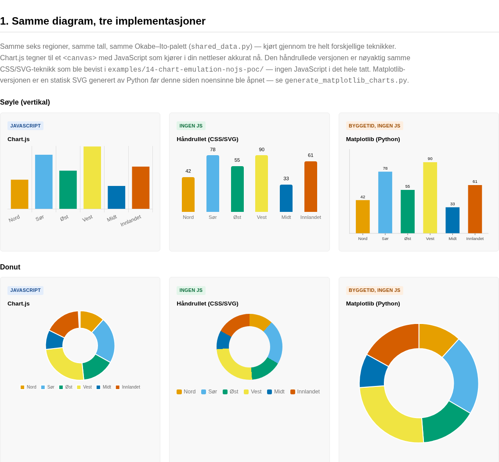
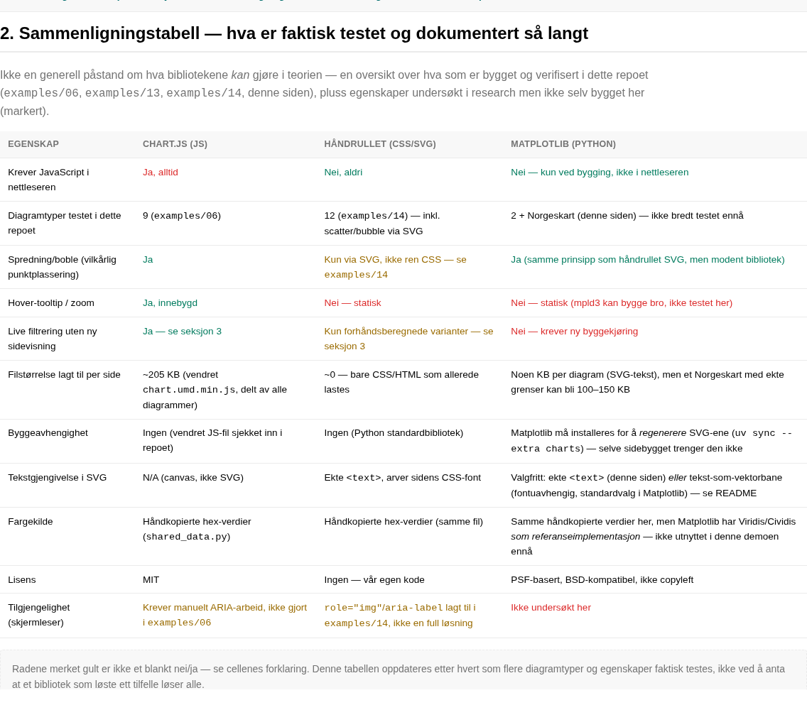
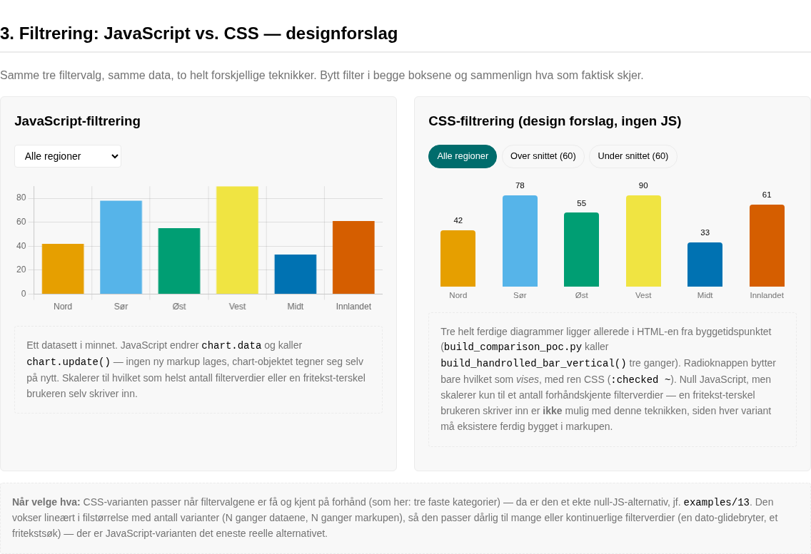
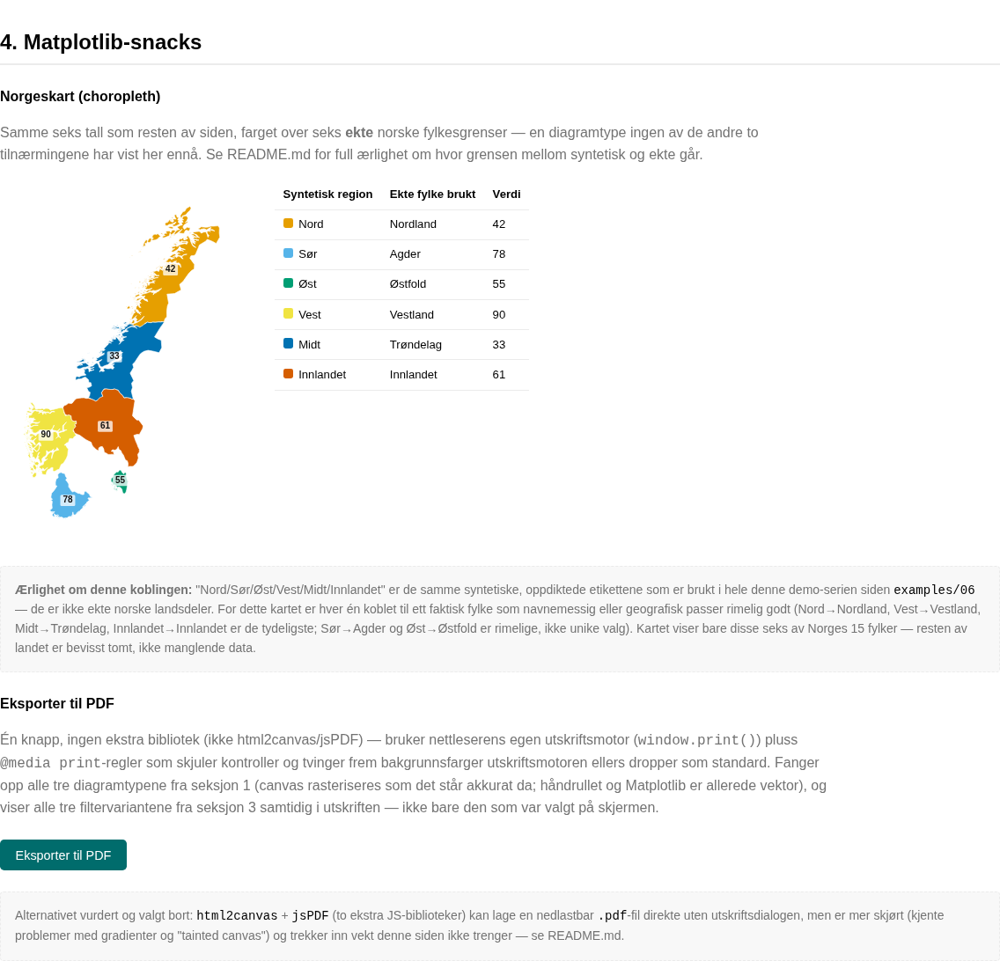

# 15 — Chart-bibliotek sammenligning: Chart.js vs. håndrullet vs. Matplotlib

Follow-up til issue #30, men med motsatt utgangspunkt av `examples/13`/`14`: **denne
siden krever JavaScript, med vilje.** Den finnes for å sette tre helt forskjellige
tilnærminger til diagrammer side om side og la forskjellen faktisk sees, ikke bare
beskrives i en tabell.



## De fire seksjonene

### 1. Samme diagram, tre implementasjoner
Søyle (vertikal) og Donut, hver bygget tre ganger — med **samme** seks regioner,
samme tall og samme Okabe–Ito-palett (definert én gang i `shared_data.py`, ikke
kopiert tre steder):

- **Chart.js** — samme vendrede bibliotek som `examples/06`, tegner til `<canvas>`
  med JavaScript som kjører når siden åpnes.
- **Håndrullet (CSS/SVG)** — nøyaktig samme teknikk som ble bevist i
  `examples/14-chart-emulation-nojs-poc/`, portert hit (ikke gjenoppfunnet).
  Null JavaScript.
- **Matplotlib (Python)** — en statisk SVG generert av `generate_matplotlib_charts.py`
  **før** denne siden noensinne blir åpnet. Den ferdige HTML-filen importerer aldri
  matplotlib — den limer bare inn SVG-teksten som allerede ligger i `mpl-svg/`.



### 2. Sammenligningstabell
Ikke en påstand om hva bibliotekene kan i teorien — en oversikt over hva som
faktisk er bygget og verifisert i dette repoet så langt (`examples/06`, `13`, `14`,
denne siden), med tydelig markering der noe er undersøkt i research men ikke bygget
her ennå.



### 3. Filtrering: JavaScript vs. CSS
Samme tre filtervalg («Alle regioner», «Over snittet», «Under snittet»), to teknikker:

- **JavaScript:** ett Chart.js-objekt i minnet. `<select>`-elementet endrer
  `chart.data` og kaller `chart.update()` — ingen ny markup, chart-objektet tegner
  seg selv på nytt. Skalerer til et vilkårlig antall filterverdier, inkludert en
  fritekst-terskel brukeren skriver inn selv.
- **CSS (designforslag fra samtalen i issue #30):** tre helt ferdige håndrullede
  søylediagrammer ligger allerede i HTML-en fra byggetidspunktet. Tre skjulte
  radioknapper + `:checked ~`-selektorer bytter bare hvilket som **vises**. Testet
  og bekreftet at det virker med JavaScript helt avslått. Skalerer **ikke** til en
  fritekst-terskel — hver variant må eksistere ferdig bygget i markupen, så teknikken
  passer kun når filtervalgene er få og kjent på forhånd.



### 4. Matplotlib-snacks
- **Norgeskart (choropleth)** over seks ekte fylkesgrenser, med samme tall som
  resten av siden. Se «Ærlighet om kartet» under for nøyaktig hvor grensen mellom
  syntetisk og ekte data går.
- **«Eksporter til PDF»-knapp** — `window.print()` + `@media print`-CSS, ikke
  html2canvas/jsPDF. Verifisert med en ekte headless PDF-eksport (Playwright
  `page.pdf()`, konvertert til bilder med `pdftoppm` for manuell sjekk): fanger opp
  Chart.js-canvasene (rastrert som de sto akkurat da), det håndrullede CSS-diagrammet,
  Matplotlib-SVG-ene, og — med vilje — **alle tre** filtervariantene fra seksjon 3
  samtidig, ikke bare den som var valgt på skjermen da knappen ble trykket.

## Ærlighet om Norgeskartet

«Nord/Sør/Øst/Vest/Midt/Innlandet» er de samme oppdiktede etikettene som har vært
brukt i hele denne demo-serien siden `examples/06` — **ikke** ekte norske landsdeler.
For dette kartet er hver av dem koblet til ett faktisk fylke (`shared_data.py`,
`REGION_TO_FYLKE`):

| Syntetisk region | Ekte fylke | Begrunnelse |
|---|---|---|
| Nord | Nordland | Navnematch + geografisk nord |
| Sør | Agder | Sørlandet, rimelig valg, ikke unikt |
| Øst | Østfold | Navnematch |
| Vest | Vestland | Navnematch |
| Midt | Trøndelag | Kjent som «Midt-Norge» i dagligtale |
| Innlandet | Innlandet | Eksakt navnematch |

Kartet viser bare disse seks av Norges 15 fylker — resten av landet er bevisst
blankt, ikke manglende data. Fylkesgrensene kommer fra
[robhop/fylker-og-kommuner](https://github.com/robhop/fylker-og-kommuner)
(CC BY 4.0, avledet fra Kartverkets offisielle grenser), filtrert til de seks
aktuelle fylkene og forenklet med `data/simplify_fylker.py` (8934 → 3635 punkter,
~41 %) — se det scriptets docstring for hvordan man regenererer fra kilden.

## Matplotlib-notater som ikke fremgår av tabellen

- **Lisens:** PSF-basert, BSD-kompatibel, **ikke copyleft**. Eneste krav gjelder
  hvis man distribuerer *selve Matplotlib-koden* videre — irrelevant her, siden
  matplotlib kun kjører ved bygging og outputen er ren SVG-tekst uten en linje
  Matplotlib-kode i seg.
- **Tekst i SVG-en er et bevisst valg, ikke standardverdien:** denne siden setter
  `svg.fonttype = "none"` (ekte `<text>`, arver sidens CSS-font, liten filstørrelse,
  men avhenger av at leserens maskin har en lignende font). Matplotlib sin egen
  standardverdi er `"path"` — hver bokstav blir en vektorbane, fontuavhengig
  uansett hvor filen åpnes, men større filer og teksten blir ikke lenger
  markerbar/kopierbar. Ikke testet med `"path"` her; verdt å sammenligne i en
  senere runde.
- **Fargekilde:** Matplotlib er selve opphavskilden til Viridis/Cividis-fargekartene
  `docs/10-chart-colour-palettes.md` allerede siterer. Denne demoen bruker likevel
  de samme håndkopierte Okabe–Ito-verdiene som resten av siden — å hente
  referanseimplementasjonen direkte er en åpenbar neste forbedring, ikke gjort her.
- **mpld3** (nevnt i tidligere samtale) — konverterer en Matplotlib-figur til en
  D3.js-basert interaktiv HTML-visning. Ikke testet i denne demoen: den hadde
  brutt med poenget i seksjon 1 (statisk vs. JS skal være tydelig forskjellige rader
  i tabellen, ikke blandes sammen).

## Hvorfor `window.print()` og ikke html2canvas + jsPDF

Vurdert og valgt bort. `html2canvas` rastreriserer DOM-en til et `<canvas>` og
`jsPDF` pakker det i en nedlastbar `.pdf` — det unngår utskriftsdialogen, men:

- to ekstra JS-biblioteker å vendre og vedlikeholde, mot null for `window.print()`
- kjente, dokumenterte problemer med CSS-gradienter og "tainted canvas" når siden
  inneholder `<canvas>`-elementer fra et annet bibliotek (nettopp vår situasjon,
  med Chart.js-canvasene i seksjon 1)
- nettleserens egen utskriftsmotor er allerede testet og godkjent i
  `docs/11-responsiveness-and-browser-support.md` §8 som det tiltenkte mønsteret

## Reproduser

```bash
uv sync --extra charts                      # kun nødvendig for å regenerere SVG-ene
python3 generate_matplotlib_charts.py       # skriver mpl-svg/*.svg på nytt
python3 build_comparison_poc.py             # bygger selve HTML-filen — ingen matplotlib-avhengighet her
python3 ../../tools/verify_standalone_core.py chart-library-comparison-poc.html
```

The three charts are drawn in a fixed coordinate space and scaled to their card, so the
axis text is not 14 px at every width: from 1366 px up its smallest label is 10 px, and
narrower than that the drawing scales with the window. The artefact therefore declares
its floor, and overflow and touch targets are still checked at every width:

```bash
python3 ../../tools/verify_viewports.py chart-library-comparison-poc.html \
    --text-floor 10 --text-floor-above 1366
```

## Filer

- `shared_data.py` — data + palett, definert én gang, brukt av alle tre
  implementasjonene og av Matplotlib-scriptet.
- `generate_matplotlib_charts.py` — skriver `mpl-svg/*.svg`. Krever
  `uv sync --extra charts` (se `pyproject.toml`). Ikke en avhengighet av selve
  sidebygget.
- `build_comparison_poc.py` — genererer selve HTML-filen. Ingen tredjeparts-import
  utover standardbiblioteket.
- `chart-library-comparison-poc.html` — den genererte, selvstendige filen (~0,39 MB,
  størstedelen er det vendrede Chart.js-biblioteket + Norgeskartets SVG).
- `mpl-svg/*.svg` — Matplotlib sine ferdige, statiske SVG-er (sjekket inn, ikke
  regenerert ved hvert bygg).
- `data/fylker-6.geojson` — forenklede grenser for de seks fylkene kartet bruker.
  `data/simplify_fylker.py` — scriptet som produserte den, med full kildehenvisning.
- `vendor/chart.umd.min.js` — samme vendrede Chart.js 4.4.0 som `examples/06`.
- `preview-sec-*.png` — skjermbilder av hver seksjon, til manuell gjennomgang.
