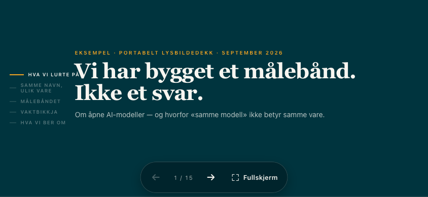
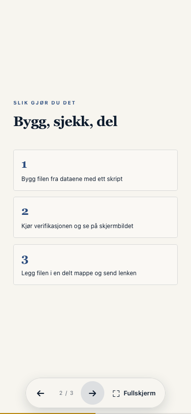

# 18: Portable slide deck

A synthetic sample deck: three slides about sharing a dashboard as one file, built from
`templates/portable-slide-deck.html`. The content is invented. The point is the shell
around it.




## What this proves

`sample-deck.html` is one file of about 16 KB with no remote dependencies. It opens from
`file://` and needs no server after download. The same file can also be hosted unchanged
when a URL is the easier delivery route.

The shell, inherited unchanged from the template, provides:

- persistent Previous, Next, slide count, and Fullscreen controls;
- 48 px touch targets;
- keyboard, button, and swipe navigation;
- portrait and landscape layouts;
- `100dvh` with a `100vh` fallback;
- safe-area handling for mobile browser chrome;
- standard and WebKit fullscreen paths;
- a visible fallback message when fullscreen is unavailable;
- a useful first slide and platform-neutral warning when JavaScript does not run.

The final point matters for attachment viewers such as Apple Quick Look. A host may refuse to
execute JavaScript even though the exact same bytes work in a browser. The artefact cannot
override that security boundary. It can avoid looking blank and tell the reader what to do.

Colours come from `tools/tun_tokens.py`, like every other builder: core's neutral palette
unless a brand plugin supplies one.

## Build

```bash
python3 examples/18-portable-slide-deck/build_sample_deck.py
```

The builder keeps everything outside `<main>` byte for byte, replaces the template's sample
slides with its own three, and fills the provenance placeholders.
`tests/test_portable_slide_deck.py` asserts that the shell still matches the template.

## Verify

Structural tests need only Python:

```bash
python3 tests/test_portable_slide_deck.py
```

Run Tún's generic checks:

```bash
python3 tools/verify_standalone_core.py examples/18-portable-slide-deck/sample-deck.html
python3 tools/verify_viewports.py examples/18-portable-slide-deck/sample-deck.html
python3 tools/verify_nojs_fallback.py examples/18-portable-slide-deck/sample-deck.html
```

Run the slide-specific Chromium and WebKit matrix:

```bash
uv run --extra verify python tools/verify_slide_deck.py \
  examples/18-portable-slide-deck/sample-deck.html \
  --out /tmp/sample-deck-verification
```

The last command visits every slide at 1600×900, 1366×768, 844×390, and 390×844 in both
engines. It checks controls, navigation, JavaScript errors, external requests, and
fullscreen or its fallback. It writes one screenshot per slide and a contact sheet per
engine and viewport for human review. The two previews above are its WebKit screenshots of
slide 1 (landscape) and slide 2 (portrait).

## Reuse

Start from `templates/portable-slide-deck.html`: `python3 tools/build_slide_deck.py --out deck.html`
writes it in Norwegian, and `--lang en` writes it in English. To keep your own slides in a
script, copy `build_sample_deck.py`: it calls the same builder with its own `TITLE` and
`SLIDES`. Keep the shell and controls, then run all four checks above against the built file.
