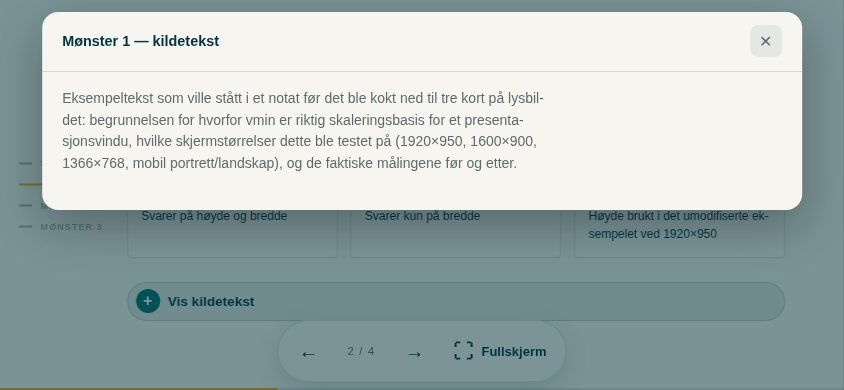
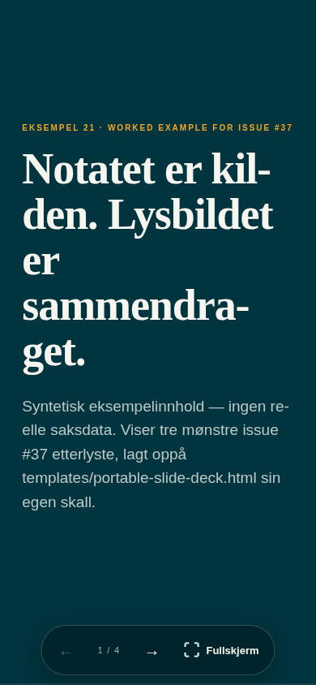

# 21 — Detail overlay, vmin typography, and extended keyboard map

The worked example requested on issue #37:
*"what we still need: a worked example that shows the overlay pattern"*. Demonstrates,
on a real renderable file — not just prose — the three patterns issue #37's own comment
thread identified from a pitch deck built outside this repo:

1. **vmin-based typography** — `clamp()`'s middle term uses `vmin` (the shorter of
   viewport width/height) instead of `vw`.
2. **Detail overlay** — a pill under a slide's content opens a panel with the full
   source paragraph, so the slide itself can stay to one claim.
3. **Extended keyboard map** — `N`/`P` letter aliases, `Enter` to advance, digit(s)+`Enter`
   to jump to a slide, `B` for a blank/black screen — layered on top of the existing
   map, which is unchanged.

Content is synthetic — no real case data, no organisation name.




## What this is not

This is **not** a proposal to replace `templates/portable-slide-deck.html`, and it does
not change that file's own typography (only a small, unrelated, unconditional
`overflow-wrap` safety net was added there — see the PR description). Issue #37's own
thread already flagged that graduating vmin typography or the overlay pattern into the
core template is a maintainer decision, not something to bake in unilaterally:

> vmin typography and overlay pattern are the two things most worth graduating into the
> template. [...] should review before anything is merged.

This file is the requested evidence for that review, not the review's outcome.

## Pattern 1 — vmin typography, measured before building anything

Before adding vmin anywhere, the unmodified `templates/portable-slide-deck.html` was
measured, not assumed to have the same characteristic as the pitch deck referenced in
#37. Its "Forklaring" slide (heading + three stat cards) at 1920×950 — an unmaximised
browser window on an external monitor, a common real case, not a constructed edge
case — used roughly **36% of viewport height**, because every `vw`-driven `clamp()`
value had already hit its ceiling. The cover slide, by contrast, looked intentionally
spacious at the same size — its content is sparse by design. The mechanism is the same
in both cases (`vw` is blind to height); whether it reads as a defect depends on the
slide's own content density, which is a per-deck design choice, not a bug to fix
globally.

This file's clamp ceilings are raised so `vmin` has room to keep scaling on wide-short
windows, with coefficients chosen so normal-ratio screens (the repo's own reference
viewports, 1600×900 and 1366×768) render within a few pixels of the original `vw`
output — this is a scaling-basis change, not a visual redesign.

## Pattern 2 — detail overlay, one positioning bug found and fixed

`#detail-backdrop`/`#detail-panel` are siblings of `<main>`, appended directly to
`<body>` — not nested inside `.slide` or `<main>`. `.slide` has `overflow:hidden` (kept
for the slide-change transform); an earlier version nested the panel inside `.slide`
and its bottom edge was silently clipped on shorter screens even though `top`/
`max-height` were computed correctly in isolation. Same family of problem as
`docs/01-tenant-constraints.md` row 26 (an ancestor's scroll/overflow handling breaking
something that must stay correctly visible) — a different concrete cause (`overflow:
hidden` clipping a fixed-positioned descendant, not `position:sticky`/`fixed`
misbehaving specifically in SharePoint's inline preview). This one reproduces in any
browser, so it is a general layout lesson, not a proposed new tenant-constraints row.

Opens on `ArrowDown` (when the current slide has a `.detail-btn`) or a click; closes on
`ArrowUp`, `Escape`, or clicking outside. Navigation keys are inert while the overlay is
open, so a stray arrow-key press cannot skip a slide behind it.

## Pattern 3 — extended keyboard map

Unchanged from `templates/portable-slide-deck.html`: `ArrowRight`/`Space`/`PageDown` →
next, `ArrowLeft`/`PageUp` → prev, `Home`/`End`, `F` → fullscreen. Added: `N`/`P` letter
aliases, `Enter` → next, digit(s)+`Enter` → jump to a slide (with a visible "Gå til
lysbilde N ↵" indicator — discoverable, not a hidden power-user trick), `B` → blank
screen (standard PowerPoint/Keynote convention; any subsequent key dismisses it without
also navigating).

## Inherited and unchanged — flagged, not fixed, see issue #47

`show()`'s `history.replaceState(null,'','#s'+(index+1))` and the startup
`location.hash` parse are copied verbatim from `templates/portable-slide-deck.html`.
Issue #47 concluded this
kind of fragment-based deep-linking is unsafe in SharePoint's inline preview,
generalising from row 24's measurement of `<a href="#...">` + CSS `:target` — a
narrower, specifically-tested case. Nobody has re-measured the actual `history.
replaceState`/`location.hash` mechanism itself inside a live SharePoint hurtigvisning,
and no automated gate catches it (`check_no_target_driven_visibility` in
`tools/verify_standalone_core.py` only scans CSS `:target` selectors). Left unchanged
here deliberately, to keep this file an honest "worked example" rather than introducing
an unverified fix alongside three unverified-in-the-real-preview patterns at once.

## Reproduce

```bash
python3 tools/verify_standalone_core.py examples/21-slide-deck-detail-overlay/detail-overlay-pattern.html
python3 tools/verify_slide_deck.py examples/21-slide-deck-detail-overlay/detail-overlay-pattern.html --out /tmp/deck-check --quick
python3 tests/test_portable_slide_deck.py
```
