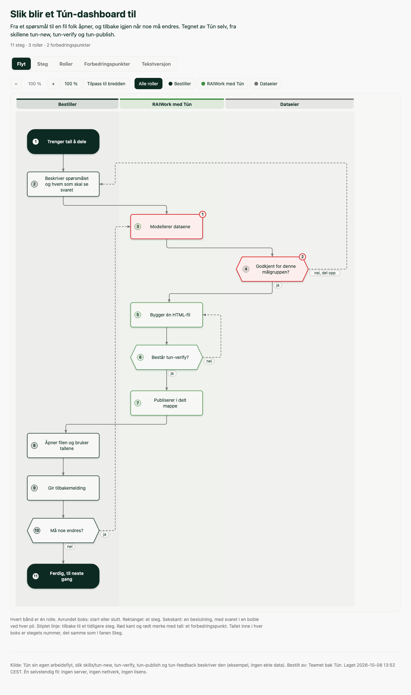

# 23: A process diagram, Tún drawing its own workflow

`tun-workflow.html` is a swimlane process diagram of how a Tún dashboard comes to exist:
the request, modelling the data, approval for the audience, the build, `tun-verify`,
publishing, and the feedback that sends it round again. Two steps are flagged as places
to improve.

It is built by `tools/build_process_diagram.py` from `tun-workflow.process.txt`. Nobody
writes the HTML by hand. `tests/test_process_diagram.py` rebuilds it and fails if the
committed file differs from what the builder makes (apart from the build time).



## What it shows about the format

- Three lanes (who does it), eleven numbered steps, thirteen connections, in Tún's own
  palette (`palette: plugins/tun/tokens/palette.css` in the spec).
- Three decisions. Each outcome sits in a pill beside its arrow: `ja`, `nei`,
  `nei, del opp`.
- Three dashed loops back: a refused approval goes back to describing the request, a
  failed verify goes back to the build, and "something must change" goes back to
  modelling. Each leaves its box on the right and climbs its lane's own gutter.
- One crossing in the whole drawing, pinned as a ceiling in the test. Before loops got
  their own gutters there were six.
- Two improvement points: a tinted box with a numbered badge, and a card with the
  problem and the proposal.
- Every step has a card. Each says what happens, and most also give input, output and
  tool, as far as the skills say them. Two have a duration, and those two were measured (`tools/build_dashboard.py` and `tools/verify_dashboard.py`
  on examples/01, 776 rows). The skills state no durations, so the other steps have
  none.

## Two layers

With JavaScript off, five sections show one after the other: the flow, the step cards,
the roles with their hand-offs, the improvement points, and a text version. That is also
what print shows.

With JavaScript on, the same sections become tabs («Flyt», «Steg», «Roller»,
«Forbedringspunkter», «Tekstversjon»). Click a step, or give it Enter, to open its card
beside the drawing. Hover or focus a step to light its connections. A role chip keeps
one lane. «Vis i flyten» on a card jumps to the step. Zoom and fit-to-width sit above
the drawing. No URL fragment, no network, works from `file://`.

## Rebuild

```bash
python3 tools/build_process_diagram.py \
  examples/23-process-diagram/tun-workflow.process.txt \
  --out examples/23-process-diagram/tun-workflow.html
```

`source:`, `requested-by:` and `palette:` live in the spec, so a rebuild cannot lose them.

## Verify

```bash
uv run --extra verify python tools/verify_process_diagram.py \
  examples/23-process-diagram/tun-workflow.html \
  --spec examples/23-process-diagram/tun-workflow.process.txt --max-crossings 1
```

It opens the file from `file://` in Chromium, Firefox and WebKit. It checks the drawing
against the spec, and drives the page like a reader: tabs by keyboard, every panel's
content, detail panel, highlight, role filter, zoom, «Vis i flyten», print, and no text
under 12 px. Then it opens the file with JavaScript off. It writes
`tun-workflow.<engine>.verify.png` beside the file (gitignored). Look at them.

`--mutation-check` breaks copies of the file in nineteen ways, in a temp directory, one
per behaviour, and requires each break to be caught by the check aimed at it.

Firefox inside a sandboxed agent session may fail to start its own content sandbox
(`sandbox_init() failed`). Setting `MOZ_DISABLE_CONTENT_SANDBOX=1` for that run fixes it.
A normal desktop session does not need it.

## Files

- `tun-workflow.process.txt`: the spec, the only file a person edits
- `tun-workflow.html`: the built diagram
- `preview.png`: the Chromium screenshot from the verifier
