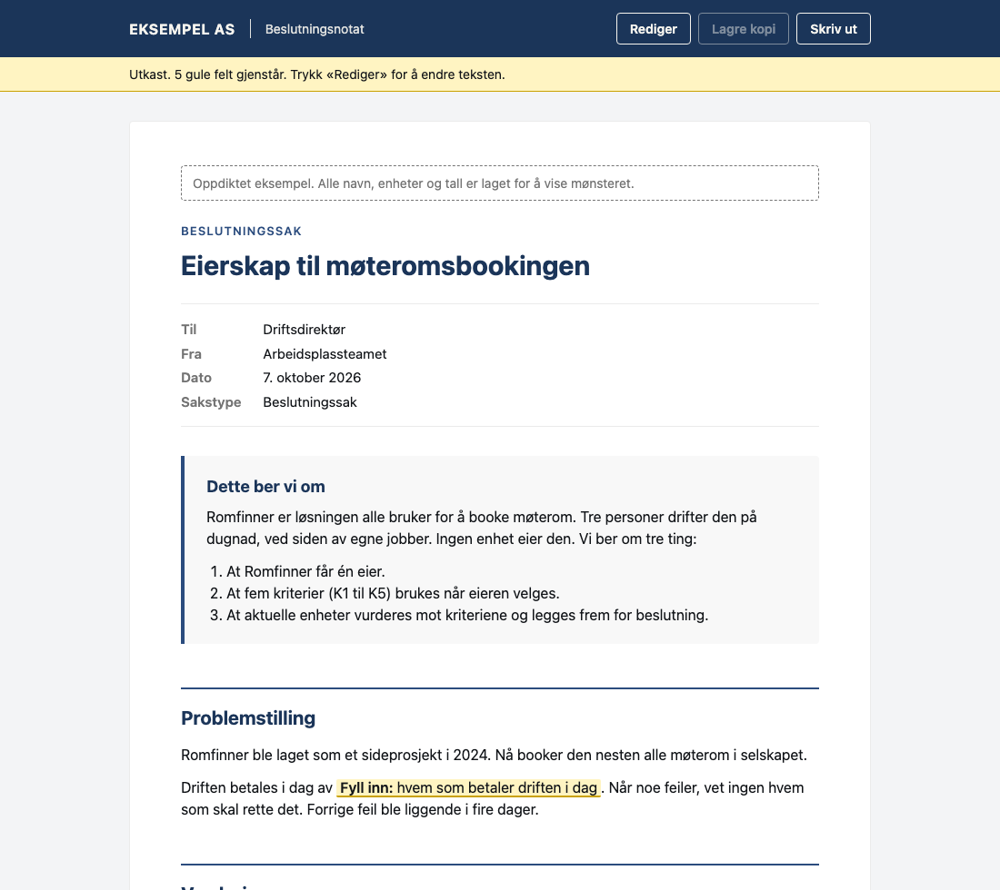
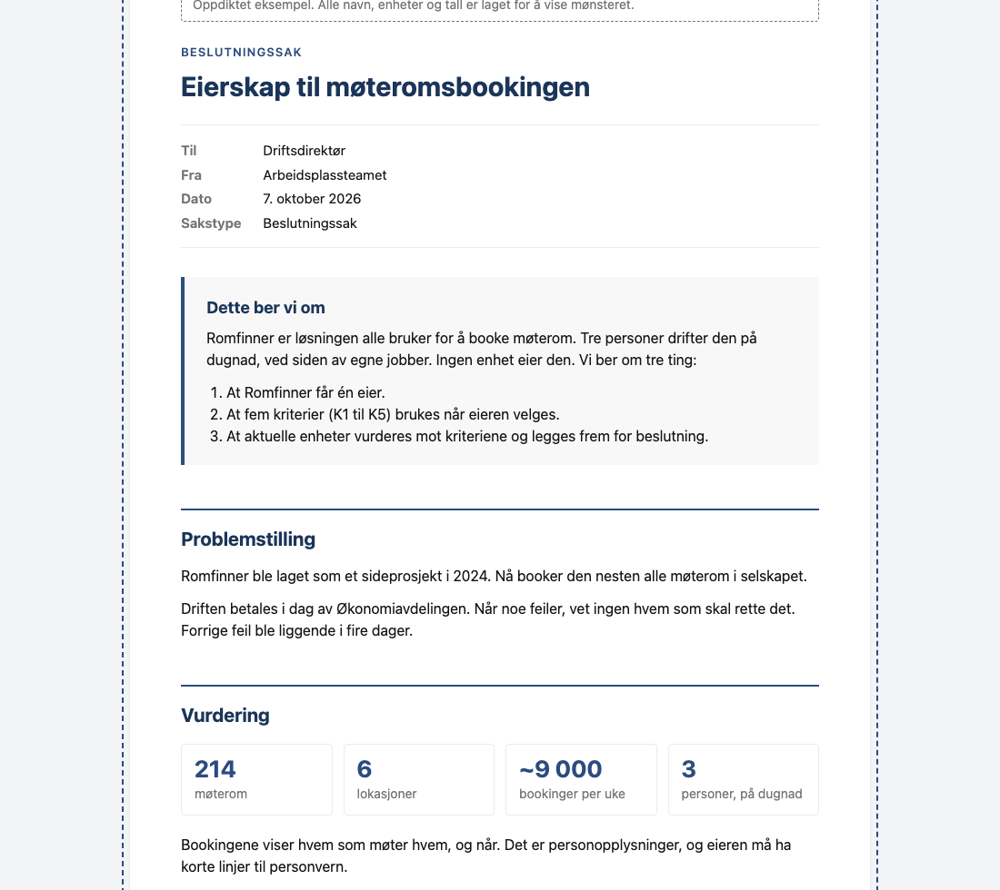
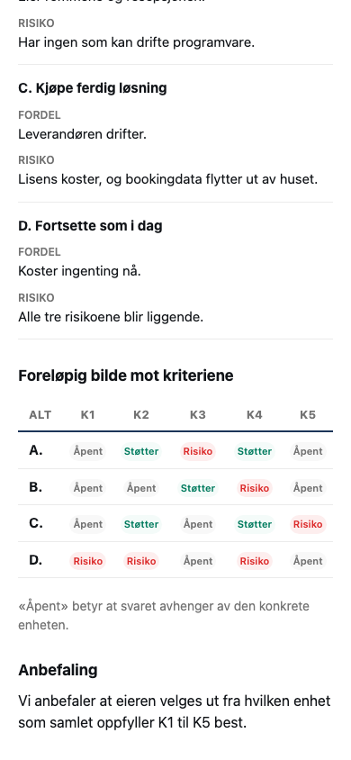

# 24 — Editable document: change the text in the browser, download a copy

A decision memo as one self-contained file. It reads like any other Tún artefact. With
JavaScript, a **Rediger** button turns the page editable, and **Lagre kopi** (or Ctrl+S /
⌘S) downloads an edited copy.

Every name, unit and number in the memo is invented: a company called Eksempel AS, a
room-booking tool called Romfinner. Nothing comes from a real case.





## Why this is in Tún

**It is the first artefact with no rows.** `docs/08-generic-artifact-model.md` names
"a documentation page" and "a markdown-backed executive summary" as things the generic
layer should carry. This is one. `tools/verify_standalone_core.py` passes on it unchanged,
which is evidence the generic layer really is generic.

**It works with the tenant, not around it.** SharePoint forces `Content-Disposition:
attachment` on every file (`docs/01`, rows 1 and 2, and AGENTS.md rule 2). Saving does not
fight that. It is the measured route from row 18, `Blob` plus `<a download>`: the edited
memo leaves the browser as a new download, exactly as the original arrived.

**It replaces "open the HTML in a text editor".** Hand-over notes for artefacts built
outside this repository have told readers to open the file in Notepad or TextEdit and
change only the words between `>` and `<`. For a reader who is not a developer, clicking **Rediger** is the
better answer.

## How it works

- The tools are in the markup with `hidden`, and the script reveals them. Without
  JavaScript (row 22: SharePoint on a phone), the memo reads normally and no dead buttons
  show. `[hidden]{display:none!important}` is required: without it, the toolbar's own
  `display:flex` overrides the `hidden` attribute.
- **Rediger** sets `contenteditable` on the memo. Typing works in headings, lists and
  tables.
- A yellow `.fill` field is yellow while its text is still its hint. Clicking one selects
  all of it, so typing replaces the hint instead of joining it. The marking goes when the
  text changes and comes back if the hint returns (undo, say), and the strip counts what
  is left. Emptying a field deletes the element itself, in all three engines, so a
  deleted field simply goes.
- Paste inserts plain text, so formatting from a word processor does not come along.
- **Lagre kopi** builds the copy from the page *as it was opened*: the script keeps that
  markup before it changes anything, and a save puts the edited memo and a "Sist redigert"
  footer stamp into it. So no live edit state can reach the copy (`contenteditable`, the
  `editing` class, visible tools, the live status text), by construction rather than by a
  list of things to undo. The copy is named like the open file.
- **In SharePoint's inline preview, no editing is offered.** The preview runs the file in
  `<iframe sandbox="allow-scripts">`, where downloads and print are blocked (`docs/01`,
  row 28). An edit there could never be saved, and the first version let you make one and
  then lose it without a word. Now the script sees the sandboxed frame, keeps the tools
  hidden, and the strip says: download the file and open it from disk.
- Closing the tab with unsaved changes asks first (`beforeunload`).
- The tools and the strip are hidden in print. The memo prints to A4.

## Measured, and not measured

**Measured** by `verify_editable_document.py`, from `file://`, in Chromium, Firefox and
WebKit: everything in "How it works" except undo, `beforeunload` and print. (Re-marking is
checked by typing the hint back, not by pressing undo.) That covers edit,
save, the state of the saved copy, reopen and edit again, the no-JavaScript render of both
the original and the copy, and zero console errors. Paste is checked in Chromium only,
with a synthetic clipboard event.

The verifier also rebuilds SharePoint's preview frame (a `blob:` iframe with
`sandbox="allow-scripts"`) and checks, in all three engines, that no editing is offered
there.

**Measured in the live tenant** (2026-10-08, `docs/01` row 28): the preview's frame and
its `sandbox` value, read from the host page. In a replica of that frame, editing worked
and saving did not, in all three engines; a control arm with `allow-downloads` did
download. After the guard was added, the live preview showed the memo with no tools.

**Not measured:**

- A link opened from Teams, on PC and on a phone (rows 21 and 22 cover other files, not
  this one).
- A file opened from a OneDrive-synced folder is a `file://` page, which is what the
  verifier tests. Where the copy lands is the browser's download setting, not the synced
  folder; this was not tried on a synced file.

## Limits, stated plainly

- **A save is a new file.** A browser cannot overwrite the file it opened. The copy goes
  to the download folder, often as `name (1).html`. To keep one file, replace the old one
  with the copy.
- **No locking.** Two people editing their own copies will each produce a different file.
  `docs/01` already explains why a `file://` page cannot take or release a lock (the
"one safe writer" section).
- **`document.execCommand('insertText')` is deprecated.** Every current engine still
  supports it. The paste handler falls back to a `Range` insert if it returns `false`.
- **Edit from disk, not from the preview.** Download the file first. In the preview the
  memo is read-only, by design.
- **Edit mode is for a desktop browser.** It runs on a phone, but editing a memo there is
  not a use case this example tries to serve.

## Reproduce

```bash
# 1. Build (stdlib only). Inlines the neutral palette through tools/tun_tokens.py.
python3 examples/24-editable-document/build_editable_document.py

# 2. Open examples/24-editable-document/editable-document.html in a browser, from disk.

# 3. Automated proof, in Chromium, Firefox and WebKit:
uv sync --extra verify
uv run playwright install chromium firefox webkit   # once
uv run --extra verify python examples/24-editable-document/verify_editable_document.py
uv run --extra verify python tools/verify_standalone_core.py examples/24-editable-document/editable-document.html
```

Both must print `✓ PASS`. Then look at the page: a check cannot see layout.

### Mutation self-check

```bash
uv run --extra verify python examples/24-editable-document/verify_editable_document.py --mutation-check
```

This removes, one at a time, eight behaviours this README claims: (1) the no-JS hiding
rule, (2) the script revealing the tools, (3) a field's marking following its text, (4) a
field being re-marked when its hint returns, (5) click-to-select, (6) plain-text paste,
(7) building the copy from the opened page, and (8) the copy carrying the edit. Each must
make at least one check fail. The mutations are written to copies in a temporary
directory, so an interrupted run cannot leave a broken file behind. Last run: all 8 caught.

## Files

- `notat.template.html` — the memo, its CSS and the edit-mode script. Edit this, not the
  built file.
- `build_editable_document.py` — inlines the token CSS and the build date, refuses to
  write a file with an unsubstituted placeholder. `SOURCE_DATE_EPOCH` makes it
  byte-reproducible.
- `editable-document.html` — the built artefact.
- `verify_editable_document.py` — the browser verification and `--mutation-check`.
- `preview-*.png` — the screenshots above, from Chromium.
