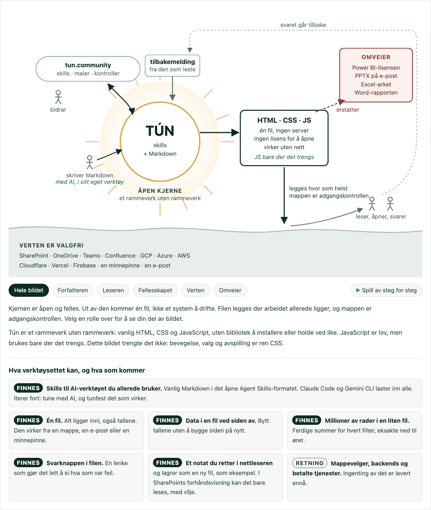
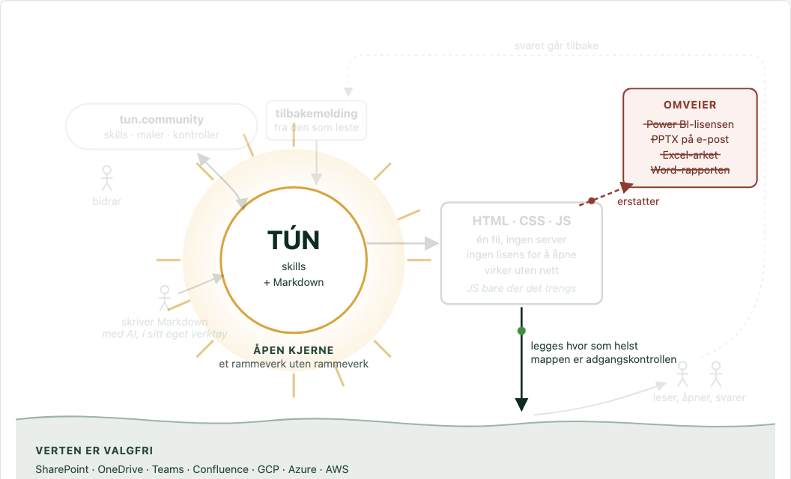
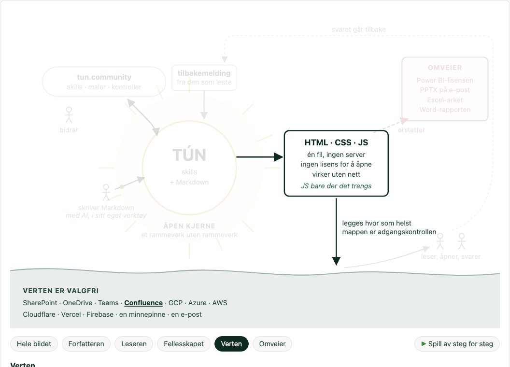
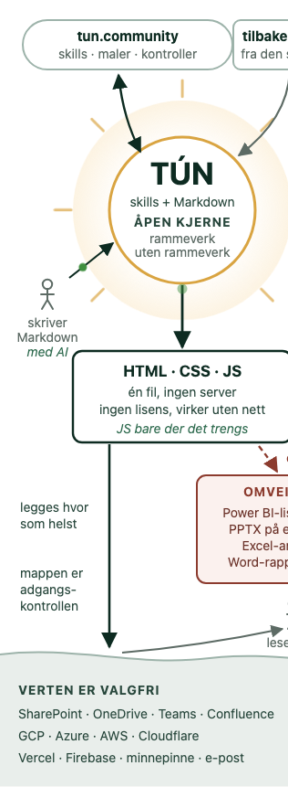

# 25 — The idea, alive: a moving, explorable picture with no script

The whole Tún idea as one figure that moves, can be explored, and plays step by step,
in CSS and SVG only. It is the picture on tun.community/ide. That page has no
JavaScript, and neither does this.



| Playback, step 3 | Lens «Verten», SharePoint chosen | Phone |
|---|---|---|
|  |  |  |

## JavaScript when needed, a framework without a framework

Tún allows JavaScript, but uses it only where it is strictly needed. The output is plain
HTML, CSS and, when it earns its place, JavaScript, with no library to install or keep up
to date: a framework without a framework. The picture says this itself (the file box
reads «HTML · CSS · JS, JS bare der det trengs», the core «et rammeverk uten
rammeverk»). The picture is also an example of it: motion, lenses and playback did not
need script, so it has none.

## What it does

- **It moves.** Small packets travel along the arrows (CSS `offset-path`): Markdown
  into the core, the file out, down onto a host, to the readers, and back up the dashed
  loop as an answer. The sun breathes. The detour items are struck through one by one.
- **You can explore it.** Six chips under the picture: the whole picture, Forfatteren,
  Leseren, Fellesskapet, Verten, Omveier. Choosing one lights its part of the picture,
  dims the rest, and opens its text. Verten has its own chips (SharePoint, OneDrive,
  Teams, Confluence, e-post, minnepinne, sky). Each one shows one line about what was **measured**
  there, and lights that host's name on the ground.
- **It plays.** «Spill av steg for steg» runs the four steps in a 12-second loop, with a
  caption for each step, timed to the motion.
- **It says where it is going.** The first idea card, full width: Tún as a plugin for the
  AI tools and agent harnesses people already use, so they can iterate fast («tune med AI,
  og tunfest det som virker»). The author in the picture writes Markdown «med AI».
- **It stays honest.** The idea cards say **Finnes**, **På vei** or **Retning**, never
  more than is true. The plugin is **På vei**: today it is packaged for one harness.
- **Phone:** a second, taller picture replaces the wide one, so the text stays readable
  instead of shrinking. Which one shows is asked of the picture's own box
  (`container-type:inline-size`), not of the window: under 1000 px of stage the tall
  canvas replaces the wide one, and under 400 px the stage scrolls sideways with a line
  of text saying so. The two canvases hold their own width (`min-width`), so the labels
  are 14 px on screen at every width. Scaling the wide canvas down instead was the old
  bug: a 14 px label reached the reader at 11.6 px while a gate reading CSS reported 14.
- **Reduced motion:** no packets, no animation. Playback shows the four captions as a
  still list.
- **Print:** one still picture, fully lit, with every lens text and host line as a list.

## How it works without script

All state lives in hidden form controls placed **before** everything they affect:

- radios `name=lv-lens` (`#lv-all` checked by default) and `name=lv-host`;
- a checkbox `#lv-play`.

Each chip is a `<label for=…>`. CSS reads the state with the sibling combinator
(`#lv-host:checked ~ .lv-stage .l-host`). No `:has()` and no `:target` are needed, so the
picture avoids constraints row 24.

Each SVG group says what it belongs to in its class list. That class list is the whole
data model:

- `l-author l-host …` are the lenses that light it;
- `s1`–`s4` is the playback step it belongs to (`s0` is always lit).

Playback is one 12-second clock. Every group, packet and caption runs the same
keyframes, with a negative delay that puts step *n* at (n−1)/4 of the cycle. Toggling
the checkbox restarts them all together, so they stay in sync.

## The builder

`build_idea_picture.py` (stdlib only) writes what would otherwise be written twice:

- **`PATHS`**: one entry per arrow. Each entry is the SVG `d` *and* the `offset-path`
  its packet follows. The build fails if the figure names a path that does not exist, or
  never draws one that does.
- **`LENSES`, `HOSTS`, `STEP`**: the selectors that tie each control to what it lights
  are generated from these lists. A new lens is one list entry plus its `l-` classes and
  panel.

It writes `idea-picture.html` (the page) and `figure.css` (the figure's CSS alone).

## Verify

```bash
python3 examples/25-living-idea-picture/build_idea_picture.py
uv run --extra verify python examples/25-living-idea-picture/verify_idea_picture.py
uv run --extra verify python tools/verify_viewports.py \
  examples/25-living-idea-picture/idea-picture.html
```

The first opens the page from `file://` in every engine and checks what the picture
claims: each lens lights its own groups and dims the rest, each host shows only its line,
playback runs the steps in order, reduced motion stops the animation, and nothing reaches
the console. The second checks the floors `docs/11` sets: 44 px targets, no overflow, and
no text under 14 px at any of six viewports. The picture needed both: porting the
site's container-query geometry (it had carried the older `31rem`/`52rem` breakpoints and
12–13.5 px labels) was the change that made regeneration safe again.
`SOURCE_DATE_EPOCH` makes the build date reproducible.

The wide and the tall picture are two hand-drawn layouts. A new element must be added to
both.

## On tun.community

The public page `web/ide.html` (in the site's own repository) carries a **copy**:

- the markup between `<!-- figure:start -->` and `<!-- figure:end -->`;
- `figure.css` between `/* figure-css:start */` and `/* figure-css:end */`.

Its provenance block names this folder. Change the picture here, rebuild, and copy both
blocks. The site's own gates (`page_test.go`: no script, nothing remote, the hard-limit
sentence, ≤ 64 KB; `verify-preview.py --page idea`) then check the copy.

## Facts on the picture

Every host line is a measurement, not a guess:

| Host | Source |
|---|---|
| SharePoint | file link downloads, `docs/01` row 1. The inline preview is a sandboxed frame where nothing can be downloaded or printed, measured 2026-10-08 (row 28, in the open PR for example 24) |
| OneDrive | synced folder opens from disk, row 7. Link in an e-mail works on PC and is inert on a phone, row 22a |
| Teams | link opened from the preview card works on PC and phone, and the plain text link shows source, rows 22b–c |
| Confluence | a file in Atlassian Artifacts runs in a sandbox, alone and inside a Confluence page: a sibling data file never loads, nothing persists between visits, and a published file is open to the organisation by link. Measured 2026-10-13, [`docs/29`](../../docs/29-atlassian-artifacts.md) |
| E-post | Outlook on iOS: no script runs, the static page reads, `docs/11` (2026-09-28) |
| Minnepinne | the downloaded file works offline on PC and phone, the site's sharing table |
| Sky | a static host serves the file as it is. An edge network can inject a script: Cloudflare once added an e-mail decoder script to tun.community |

## Reproduce

```bash
python3 examples/25-living-idea-picture/build_idea_picture.py
uv run --extra verify python examples/25-living-idea-picture/verify_idea_picture.py
uv run --extra verify python examples/25-living-idea-picture/verify_idea_picture.py --mutation-check
```

The verifier runs Chromium, Firefox and WebKit from `file://`. It checks:

- no script, and the generic core checks;
- the wide/tall swap, with no sideways scrolling on a phone;
- that a packet really moves;
- every lens (its groups lit, the rest dimmed, its own panel);
- the SharePoint line and its lit name;
- the four detours named in the Omveier text;
- playback at 1.5 s and 4.5 s (the right step, the right caption);
- reduced motion;
- zero console errors.

The mutation check removes six behaviours one at a time, and each must fail at least one
check: the lens dimming order, the phone picture hidden on desktop, packet paths,
playback phases, packets hidden under reduced motion, and the chosen host lit. Last run:
81 checks pass, all 6 mutations caught.

Note for anyone writing a verifier like this one: Playwright's *element* screenshot
restarts CSS animations, and so does a full-page screenshot. Seek with
`document.getAnimations()`, then take a page screenshot with a `clip`.

## Limits

- `offset-path` needs Safari 16+ or Firefox 72+. In an older browser the packets do not
  move, and the picture and every text still read.
- Hidden radios in SharePoint's inline preview are not measured. The public site is a
  plain browser page.
- The figure is about 33 KB, most of it two SVGs. The public page is 47 KB of its 64 KB
  budget.
