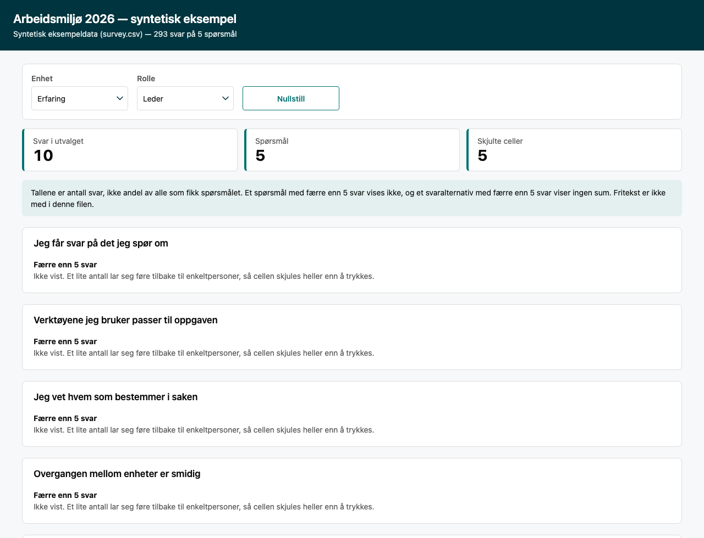

# 27 — A survey that answers where people look, without naming them

An employee survey as one file. Pick a unit and a role, and every question shows its
distribution: how many people answered, and what share chose each option. Two rules are
built into the builder rather than left to whoever assembles the file.



## What it does

- **Filters, in the browser.** One select per segment column (`Enhet`, `Rolle`), and a
  reset. Nothing is fetched: the answers travel inside the file.
- **Counts and shares, per question.** A stacked bar for the picture, one row per option
  with its count and its share of the answers to that question.
- **Withholds small cells.** A question with fewer than 5 answers is not shown, and an
  option with fewer than 5 answers shows no count and no share. The page says so twice:
  once in the note under the title, once inside each withheld card. That is k-anonymity
  applied to a table of counts, and it is the difference between a survey artefact you can
  hand to a manager and one you cannot.
- **Refuses the columns that would break it.** The builder reads the question column, the
  answer column and the segment columns, and nothing else. A respondent id, a name, an
  e-mail column: dropped before a byte is written, and `tests/test_survey_suppression.py`
  proves the names are absent from the output.
- **No free text, ever.** A sentence cannot be anonymised by a threshold, so the builder
  does not take one. A survey whose free text matters needs a different artefact and a
  human read, not this one.

## Build

```bash
python3 examples/27-survey-board/generate_data.py     # writes survey.csv (synthetic)
python3 tools/build_survey_dashboard.py \
  --data examples/27-survey-board/survey.csv \
  --title "Arbeidsmiljø 2026 — syntetisk eksempel" \
  --segments Enhet,Rolle \
  --source "Syntetisk eksempeldata (survey.csv)" \
  --requested-by "HR" \
  --out examples/27-survey-board/survey.html
```

English chrome: add `--lang en --out …/survey-en.html`. The threshold moves with
`--min-cell` (default 5), which the same command prints.

Input is long format, one row per answer given:

```
Enhet,Rolle,Sporsmal,Svar
Bemanning,Leder,Jeg får svar på det jeg spør om,4 Enig
```

`--question-col` and `--answer-col` rename the two columns if your export differs. Option
order is first-appearance order per question, so a scale reads the way it was answered.

## Verify

```bash
uv run --extra verify python tools/verify_standalone_core.py examples/27-survey-board/survey.html
uv run --extra verify python tools/verify_viewports.py examples/27-survey-board/survey.html
uv run --extra verify python tests/test_survey_suppression.py
```

The first is the generic self-containment and provenance check. The second is `docs/11`'s
floors: 44 px targets, no overflow, 14 px text, at six viewports. The third is this
artefact's own promise, in four parts: the suppression rule, a mutation that raises the
threshold and requires the output to change, the absence of every name in the source, and
a browser run that fails on any script error and requires the filter to move the numbers
and the reset to bring them back.

All three want the `verify` extra: the survey test's last part opens the page in a browser,
and it fails rather than skipping when Playwright is missing, the same way
`test_verify_gate_browser.py` does, because a check that never opened the file is not a
check.

Last run: core **PASS**, viewports **PASS** (chromium and webkit), survey test **27/27**.

## The honest limits

- **Suppression is per cell, and this board counts one question at a time.** Two
  questions multiplied is where a small group becomes one person, so a cross-tab does not
  reuse this rule: it gets its own, which is all or nothing, and it needs one row per
  respondent to pair the answers at all. That rule, and the reason it is blunt, is
  [example 31](../31-survey-crosstab/README.md) and `--cross` in the builder.
- **It counts answers, not people.** A reader who answered three questions is three
  answers. No response rate is claimed, because a long-format file cannot know who was
  asked.
- **One audience per file.** The answers are all inside the file, so everyone who can open
  it sees the same rows. Different audiences mean different files in different folders
  (`AGENTS.md` rule 1), not a filter.
- **Synthetic data.** `survey.csv` is generated by `generate_data.py`, deterministic and
  invented. No real survey has ever been built from this example.
