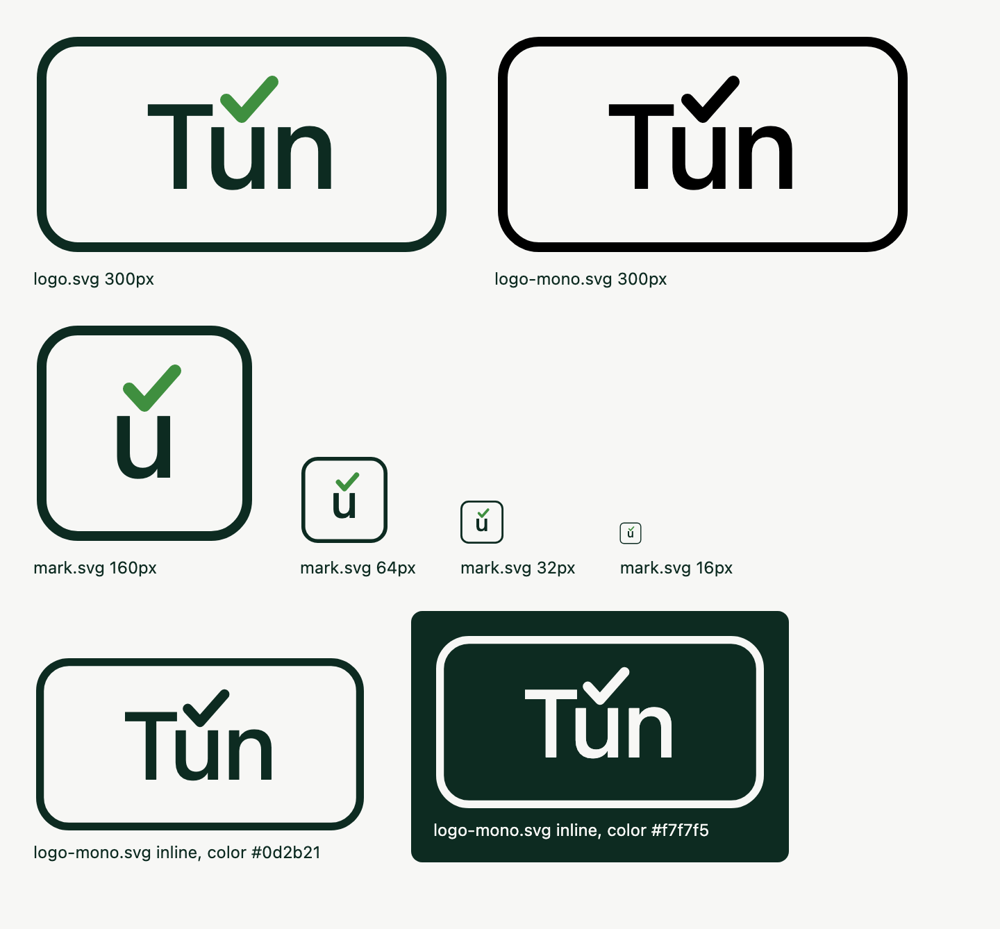

# `plugins/tun` — Tún's own brand palette and mark

This is the project's own identity: the colours used on the public site
(`tun.community`) and in the pitch artefacts, shipped as an ordinary token
plugin through the same contract `plugins/eksempel` uses. Unlike a company brand,
this one is not confidential — the colours are already public — so
`manifest.json` sets `"private": false`. It provides `tokens` and `assets`:
the logo, a square mark and a one-colour logo (see "The mark" below).

## Where the four source colours came from

Read verbatim from the public site's own `:root` block (`tun.community`; see
`AGENTS.md` §8 for why the site is never copied in here, only read):

| Site variable | Hex | How the site actually uses it |
|---|---|---|
| `--ink` | `#0d2b21` | body text (`body{color:var(--ink)}`) **and** a dark background with white/paper text on top (`.cta`, `.composition-strip`, `.snapshot figcaption` all set `background:var(--ink);color:#fff`) |
| `--ink-soft` | `#28473c` | secondary text — the lede paragraph, card copy, table captions, hover states on links |
| `--accent` | `#3f8f3f` | decorative only — the checkmark glyph in the logo, the progress-bar fill. Never body text |
| `--paper` | `#f7f7f5` | page background |

These four are the only hues `tokens/palette.css` is allowed to draw from.
Everything else in it is one of them directly, or a tint/shade of one of
them — no new hue is invented.

## The eight required slots, and how each was derived

`tools/tun_tokens.py::REQUIRED_SLOTS` / `docs/22-plugin-contract.md` §1.

| Slot | Value | Derivation |
|---|---|---|
| `--palette-ink` | `#0d2b21` | direct — site's `--ink`, used for body text |
| `--palette-surface` | `#f7f7f5` | direct — site's `--paper`, the page background |
| `--palette-primary` | `#28473c` | direct — site's `--ink-soft`. This slot's job is "primary data colour, links, focus", which is exactly how the site uses `--ink-soft` (lede text, card copy, hover emphasis) — the everyday workhorse colour, not the decorative one |
| `--palette-primary-dark` | `#0d2b21` | direct reuse of `--ink`. The slot's job is "header background", and the site already uses `--ink` as a dark background with light text on it (`.cta`, `.composition-strip`, `.snapshot figcaption`) — so this is the site's own pattern, not a new choice |
| `--palette-primary-darkest` | `#071812` | **derived**: `--ink` converted to HSL (`h=160°, s=53.6%, l=11.0%`), lightness scaled to 55% of its original value (`l=6.0%`), converted back to sRGB. Same hue and saturation family as ink, just darker — a shade, not a new colour |
| `--palette-accent` | `#3f8f3f` | direct — site's `--accent`, "the haken i Tún". The slot's job is "secondary series, decorative only", which matches exactly how the site uses it (tick glyph, progress-bar fill, never text) |
| `--palette-accent-light` | `#a4c8a3` | **derived**: `--accent` linearly mixed 55% toward `--paper` in sRGB (channel-wise lerp, t=0.55: `mix(accent, paper, 0.55)`). A tint of the accent, warmed toward the palette's own paper rather than toward pure white, so it stays inside the four given colours |
| `--palette-on-dark` | `#f7f7f5` | reuse of `--paper`. The site hardcodes `#fff` for text on an ink background, but `#f7f7f5` is visually equivalent (an off-white, 1-2% darker) and keeps this plugin from introducing a fifth hue (pure white) that isn't one of the four given colours or a derivative of them |

Two slots intentionally share a value with `--palette-ink` (`primary-dark`)
and `--palette-on-dark` (`surface`). That is not an oversight: the site
itself reuses `--ink` as both text colour and background colour depending on
context, and reuses something visually indistinguishable from `--paper` as
text-on-dark. Mirroring that is more faithful to the brand than inventing
distinct shades for slots the brand doesn't actually distinguish.

The exact derivation script (HSL scaling for the darkest shade, linear sRGB
mix for the tint) was run once to produce the hex values above; it is not
checked in as a tool because it is a one-time derivation, not something a
build needs to repeat.

## Contrast ratios (WCAG 2.x)

Computed with the standard relative-luminance formula
(`sRGB -> linear -> 0.2126R+0.7152G+0.0722B`, contrast
`(L1+0.05)/(L2+0.05)`), AA thresholds: **4.5:1** for normal text, **3:1**
for large text / non-text UI components.

| Pair | Ratio | Threshold | Result |
|---|---|---|---|
| `--palette-ink` on `--palette-surface` (body text) | 14.14:1 | 4.5:1 (normal text) | **PASS**, well above AAA (7:1) too |
| `--palette-primary` on `--palette-surface` (links/data on page bg) | 9.52:1 | 4.5:1 (normal text) | **PASS** |
| `--palette-on-dark` on `--palette-primary-dark` (text on header bg) | 14.14:1 | 4.5:1 (normal text) | **PASS** |
| `--palette-on-dark` on `--palette-primary-darkest` (text on darkest surface) | 17.05:1 | 4.5:1 (normal text) | **PASS** |
| `--palette-accent` on `--palette-surface` (decorative only, per the slot's own definition — never body text) | 3.76:1 | 3:1 (large/non-text UI) | **PASS** against the UI threshold; would FAIL 4.5:1 if ever used as small body text, which the slot definition forbids |
| `--palette-accent-light` on `--palette-primary-darkest` (highlight on dark) | 9.90:1 | 3:1 (large/non-text UI) | **PASS**, clears normal-text AA too |
| `--palette-accent-light` on `--palette-primary-dark` (highlight on dark header) | 8.21:1 | 3:1 (large/non-text UI) | **PASS**, clears normal-text AA too |

Every text-bearing pair clears normal-text AA (4.5:1). The one pair below
that threshold (`accent` on `surface`, 3.76:1) is the slot the contract
itself scopes to "decorative only" — it is never asked to carry body text,
and it clears the 3:1 UI-component/large-text threshold that actually
applies to it.

## Using it

```
# core default, no plugin — builds with the neutral palette, unbranded:
python3 examples/01-hello-dashboard/... (any example's own build script)

# with Tún's own palette:
TUN_PALETTE=plugins/tun/tokens/palette.css \
  python3 tools/build_dashboard.py ...
```

Same mechanism `plugins/eksempel/README.md` documents. `TUN_PALETTE` is an
explicit, unambiguous selection — it names the exact file to use — so it
works the same way whether this is the only plugin installed or
`plugins/eksempel` is installed alongside it.

**This plugin does not change what `--prefer-plugin` / `prefer_plugin=True`
does.** That flag means "auto-pick whichever single plugin provides
tokens", and with two plugins (`eksempel` and `tun`) both declaring
`"provides": ["tokens"]`, the auto-pick is genuinely ambiguous — the
contract (`docs/22-plugin-contract.md`) says that must be refused rather
than silently resolved last-wins, and `tools/tun_tokens.py` does refuse it,
naming both plugins in the error. That is correct, unchanged behaviour, not
a defect this plugin works around. `TUN_PALETTE` is the side-by-side
mechanism precisely because it names one file and carries no ambiguity.

## The mark

Tún and the mark are unregistered trademarks (™, never ®). The code licence
gives no right to them. See [`TRADEMARK.md`](../../TRADEMARK.md).



| File | What | How it was made |
|---|---|---|
| `assets/logo.svg` | the logo, 300 × 160 | copied verbatim from the public site, tun.community, on 2026-10-08. Only `xmlns` was added, so the file renders on its own |
| `assets/mark.svg` | square mark for favicons, 160 × 160 | derived from the logo by `assets/derive_marks.py` |
| `assets/logo-mono.svg` | the logo in one colour | derived from the logo by `assets/derive_marks.py` |

How the square mark is derived, all exact edits of `logo.svg`:

- The frame keeps its height (148) and becomes a square. Width 288 becomes
  148, and the viewBox becomes `0 0 160 160`. Margin and corner radius stay.
- Only the middle letter, `u`, is kept, at the same size and baseline.
- The text centre moves from x=150 to x=80. The check moves by the same
  amount (dx = -70), so it still sits over the `u` as its accent.

The mono logo replaces both colours (`#0d2b21`, `#3f8f3f`) with
`currentColor`. Inlined in a page it takes the colour of the text around it,
so it works on a dark background. Opened on its own it renders black.

`tests/test_token_contract.py` runs `derive_marks.py --check`, so a hand
edit of a derived file fails the suite. After a change to `logo.svg`, run
`python3 plugins/tun/assets/derive_marks.py`.

Two limits, both inherited from the logo:

- **The letters are live text, not outlines.** The glyphs come from the
  reader's system font (`-apple-system`, Segoe UI, Helvetica, Arial), so
  they differ a little per platform, the same as on the public site.
  Converting them to paths would embed outlines from a font whose licence
  nobody has checked.
- **At 16 px the `u` is barely legible.** The frame and the check carry the
  mark at that size. Look at `assets/preview/preview.png` before you choose a
  favicon size.

To use the mark as a favicon in a self-contained file, inline it as a data
URI, never as a link to a file: `<link rel="icon" href="data:image/svg+xml,...">`
with the SVG percent-encoded. Nothing in core does this yet.

To re-render the previews after a change (needs Playwright):

```
uv run --extra verify python plugins/tun/assets/render_preview.py
```

## What is still wrong / not done here

- No example or template uses the mark yet. A branded topbar that inlines
  `assets/logo.svg` is a follow-up.
- The derivation script that produced `--tun-ink-darkest` and
  `--tun-accent-tint` was run once, ad hoc, and is not checked in. If the
  source colours ever change, the formulas are documented above precisely
  enough to reproduce it.
